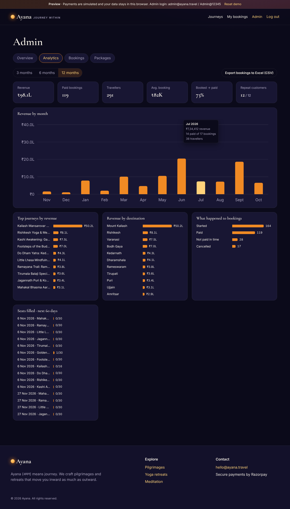
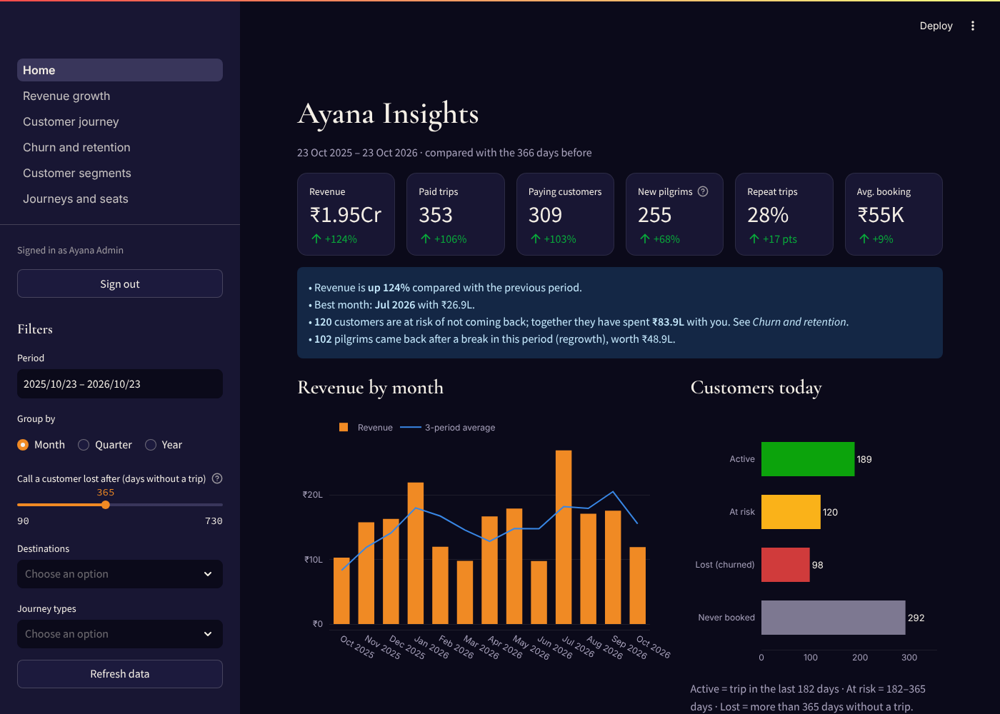

# Ayana · 3D Spiritual Travel Marketplace

**Ayana** (अयन) means *journey*. Customers walk up to 3D dhams and step through their doors, pick a pilgrimage /
yoga / meditation journey, choose a date and pay online with Razorpay. Admins manage journeys, photos and bookings,
and study customers in **Ayana Insights**, a Python analytics app covering growth, churn and how pilgrims move between dhams.


| Hover a dham to walk to its door | Admin analytics in the website | Ayana Insights (Streamlit) |
|---|---|---|
|  |  |  |

| Part | Folder | Built with |
|---|---|---|
| Website (customers + admin panel) | `client/` | React 19, Vite, three.js / React Three Fiber (3D dhams) |
| API | `api/` | **Python · FastAPI**, SQLAlchemy, Alembic, Pydantic, JWT, Razorpay |
| Analytics for admins | `analytics/` | **Python · Streamlit**, pandas, Plotly |
| Database | – | MySQL 8 / MariaDB |
| Hosting | `deploy/` | Hostinger VPS: Nginx, systemd, Let's Encrypt; auto-deploy from GitHub |

**New here? Read [docs/00-start-here.md](docs/00-start-here.md) first.**

## 📚 Documentation
0. [**Start here – overview and quick answers**](docs/00-start-here.md)
1. [Project roadmap](docs/01-roadmap.md)
2. [Architecture: HLD + LLD + tech stack](docs/02-architecture.md)
3. [Database design](docs/03-database.md)
4. [API reference](docs/04-api.md)
5. [Hosting on Hostinger (reference)](docs/05-hostinger-deployment.md)
6. [**Code walkthrough – every file explained**](docs/06-code-walkthrough.md)
7. [**Cursor → GitHub → Hostinger, and what to buy**](docs/07-cursor-github-hostinger.md)
8. [**Your data, the admin panel and analytics**](docs/08-admin-data-analytics.md)
9. [**Growing: interface, API, database and servers**](docs/09-expansion.md)
10. [**Building the Android app**](docs/10-android-app.md)
11. [**Ayana Insights – the Streamlit analytics app**](docs/11-streamlit-analytics.md)

## 🚀 Run it on your laptop (in Cursor)

**You need:** [Python 3.12+](https://www.python.org/downloads/), [Node.js 20+](https://nodejs.org) (for the website),
and MySQL – easiest with [Docker Desktop](https://www.docker.com/products/docker-desktop/).

Open this folder in Cursor, open the terminal (<kbd>Ctrl</kbd>+<kbd>`</kbd>) and run:

```bash
# 1. Database
docker compose up -d

# 2. API (terminal 1)
cd api
python -m venv .venv
source .venv/bin/activate            # Windows: .venv\Scripts\activate
pip install -r requirements.txt
cp .env.example .env                 # Windows: copy .env.example .env
alembic upgrade head                 # create the tables
python -m scripts.seed               # demo journeys + admin user
python -m scripts.sample_data        # optional: 2 years of sample customers for analytics
uvicorn app.main:app --reload --port 8000

# 3. Website (terminal 2)
cd client
npm install
npm run dev

# 4. Ayana Insights (terminal 3)
cd analytics
python -m venv .venv && source .venv/bin/activate
pip install -r requirements.txt
streamlit run Home.py
```

| Open | What |
|---|---|
| http://localhost:5173 | The website |
| http://localhost:8000/docs | Every API endpoint, with a "Try it out" button |
| http://localhost:8501 | Ayana Insights |

- Admin login (website and Insights): `admin@ayana.travel` / `Admin@12345`.
- Payments start in **mock mode**: Pay confirms instantly, no money involved. For Razorpay test payments set
  `PAYMENT_MODE=razorpay` and your `rzp_test_` keys in `api/.env`.
- Tests: `cd api && pytest` (needs the Docker database) · `cd analytics && pytest`.

## 🗂 Project structure
```
client/      React website + 3D dhams (src/three/dham/) + admin panel
api/         FastAPI: app/ (routes, services, models), alembic/ (migrations), scripts/ (seed, sample data), tests/
analytics/   Streamlit: Home.py + pages/ (revenue, journey, churn, segments, seats), ayana_analytics/ (metrics), tests/
deploy/      Nginx, systemd services, VPS setup, deploy and backup scripts
docs/        All guides
```

## ✏️ Common changes
| I want to… | Edit |
|---|---|
| Change colours / fonts of the website | `client/src/styles.css` (`:root` variables) |
| Add or change a 3D dham | `client/src/three/dham/dhams.js` (list) and `Temple.jsx` (shapes) |
| Add package photos | Website → Admin → Packages → Photos |
| Add a field to packages | `api/app/models.py` → `alembic revision --autogenerate -m "add field"` → `alembic upgrade head` → `schemas.py` + `serializers.py` + admin form |
| Change demo data | `api/scripts/seed_data.json` then `python -m scripts.seed` |
| Change seat-hold time | `BOOKING_HOLD_MINUTES` in `api/.env` |
| Add a chart to Insights | a function in `analytics/ayana_analytics/metrics.py` + a block in a `analytics/pages/` file |

## 🌐 Deploy
See **[docs/07-cursor-github-hostinger.md](docs/07-cursor-github-hostinger.md)**. Short version, on a Hostinger VPS:
```bash
bash deploy/setup-vps.sh yourdomain.com you@email.com   # once, as root
bash deploy/deploy.sh                                     # every release (GitHub Actions does it for you)
```

## 👀 Preview without a server
`npm run build:demo` builds `client/dist-demo/`, a standalone preview where the API is simulated in the browser
(`client/src/demo/`). Payments are fake and data stays in the browser. Use it to show the design; it is not the real app.
