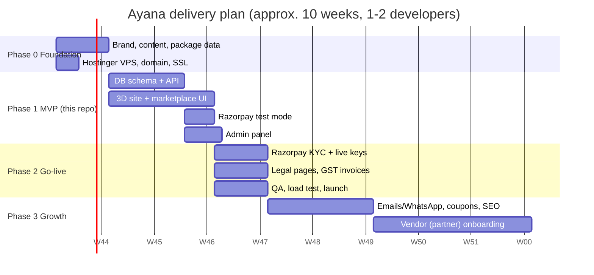

# 1. Ayana – Project Roadmap

Ayana (अयन, "journey") is an online marketplace for spiritual travel: customers browse curated
pilgrimages, yoga retreats and meditation journeys, pick a departure date, and pay online.

## 1.1 Goals

| Goal | How we measure it |
|---|---|
| Customers can find, book and pay for a journey without calling us | Online bookings / total bookings |
| A memorable, calm, 3D first impression | Bounce rate on home page, time on site |
| Owner can run the business from one admin panel | Packages, dates, seats and bookings managed without code |
| Safe payments | 0 bookings confirmed without a verified payment |

## 1.2 Phases

### Phase 0 – Foundation (week 1)
- Buy/point the domain (e.g. `ayana.travel`) in Hostinger hPanel.
- Order a **Hostinger KVM 2 VPS** (2 vCPU, 8 GB RAM) with Ubuntu 24.04. See [05-hostinger-deployment.md](05-hostinger-deployment.md).
- Create a **Razorpay** account and start KYC early (it can take several days). Business PAN, bank account, GST (if registered) and website URL with policy pages are needed.
- Collect content: package photos, itineraries, prices, inclusions, cancellation policy.

### Phase 1 – MVP (weeks 2-4) ✅ code in this repo
- Marketplace: home page where visitors walk up to 3D dhams and step through their doors, listing with filters, package detail with itinerary.
- Accounts: register / login (JWT).
- Booking: pick date + travellers → seats held for 30 min → pay → confirmed.
- Payments: Razorpay Orders API + Checkout + signature verification + webhook. Mock mode for local dev.
- Admin: dashboard (revenue, bookings), create/edit/hide packages, add departure dates, list bookings.
- Reviews from customers with confirmed bookings.

### Phase 2 – Go-live (weeks 5-6)
- Switch `PAYMENT_MODE=razorpay` with **test** keys, run every payment method (UPI, card, net banking), then switch to **live** keys.
- Add pages Razorpay requires: About, Contact, Terms, Privacy, Cancellation & Refund, Shipping/Delivery (write "services delivered on travel date").
- GST invoice PDF on confirmation (5% GST for tour operators in India – confirm with your CA).
- Real photos (upload to `/uploads` on the VPS or a CDN such as Cloudflare R2) and SEO meta per package.
- Daily DB backups (script included), uptime monitoring (UptimeRobot), error tracking (Sentry).

### Phase 3 – Growth (weeks 7-10+)
- Booking confirmation by email (Brevo/SES) and WhatsApp (Interakt/Gupshup/Meta Cloud API).
- Coupons and early-bird pricing, part-payment (pay 25 % now).
- Refund flow from admin using Razorpay Refunds API.
- Multi-vendor marketplace: local operators list their own packages; Razorpay Route splits the payment and Ayana keeps a commission.
- Blog / spiritual guides for SEO, Hindi language version, PWA.

## 1.3 Team & effort (rough)

| Role | Phase 1-2 |
|---|---|
| Full-stack developer (React + Node) | 6 weeks |
| Designer / content writer | 2-3 weeks part time |
| You (owner) | Content, Razorpay KYC, testing |

## 1.4 Monthly running cost (estimate)

| Item | Approx. cost |
|---|---|
| Hostinger KVM 2 VPS | roughly ₹600–1,000 / month on a long plan (check hostinger.in for current offers) |
| Domain | ₹800–1,500 / year |
| SSL | Free (Let's Encrypt) |
| Razorpay | ~2 % per transaction, no monthly fee |
| Email (Brevo free tier) | ₹0 to start |
