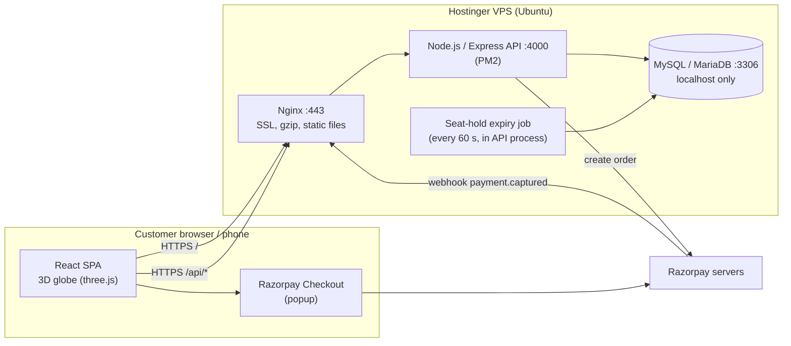
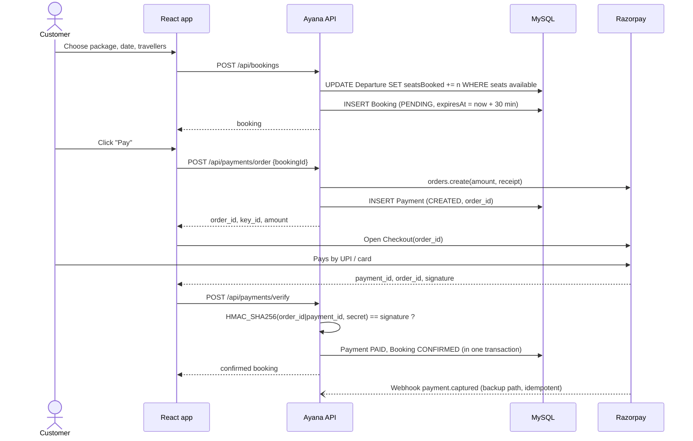
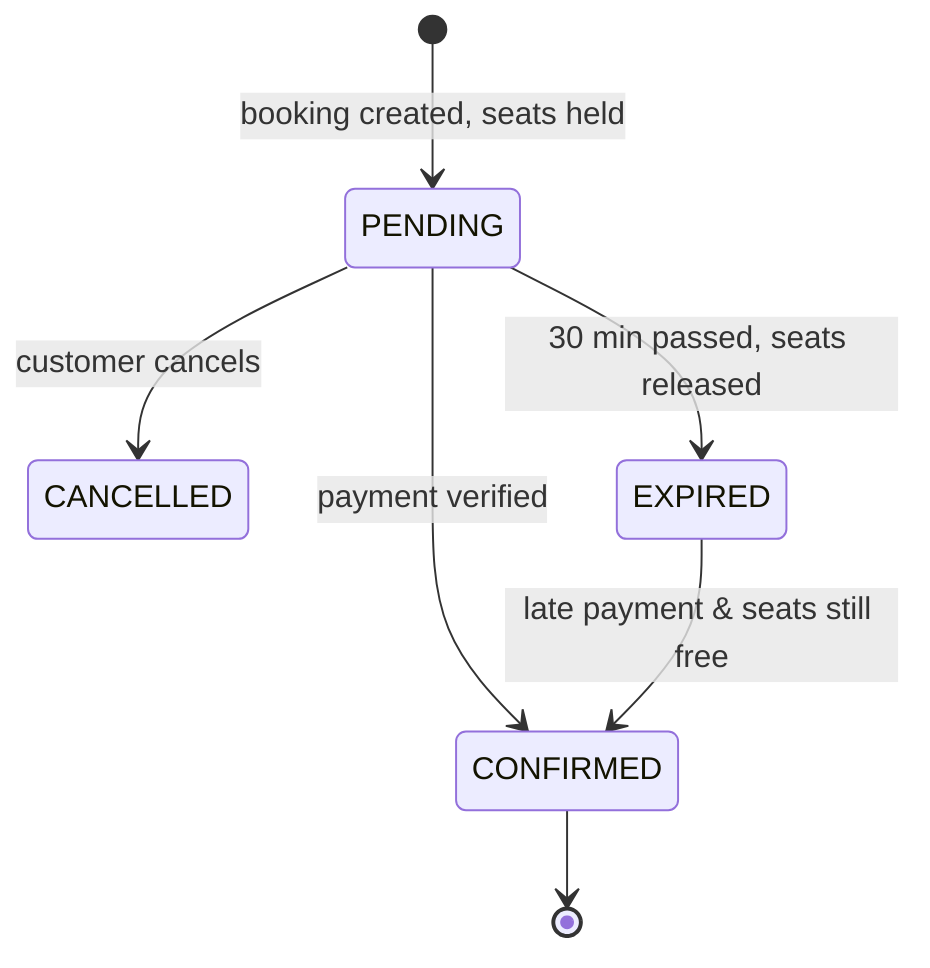

# 2. Architecture – High Level & Low Level Design

## 2.1 Tech stack

| Layer | Choice | Why |
|---|---|---|
| Frontend | **React 19 + Vite** | Fast dev server, small production build, huge ecosystem |
| 3D | **three.js + React Three Fiber + drei** | Declarative 3D in React: the globe, halo rings, stars and particles |
| Routing | React Router 7 | Client-side pages |
| Styling | Plain CSS with variables | No build plugins to learn; easy to edit in Cursor |
| Backend | **Node.js 20+ / Express 5** | Same language as frontend, simple REST |
| ORM | **Prisma 6** | Typed queries, migrations, Prisma Studio for browsing data |
| Database | **MySQL 8 / MariaDB 10.6+** | What Hostinger provides on every plan; reliable for transactions |
| Auth | JWT (Bearer token) + bcrypt | Stateless, simple |
| Validation | Zod | Every request body/query is validated |
| Payments | **Razorpay** (Orders API + Checkout + Webhooks) | UPI, cards, net banking, wallets; INR settlement to an Indian bank |
| Process manager | PM2 | Keeps Node running, restarts on crash/reboot |
| Web server | Nginx + Let's Encrypt | HTTPS, gzip, serves the static React build, proxies `/api` |
| Hosting | **Hostinger KVM VPS** (Ubuntu 24.04) | Full control, Node + MySQL on one box, cheap |

## 2.2 High level design (HLD)



**Key decisions**
1. **One domain, one server.** `https://ayana.travel` serves the React build; `https://ayana.travel/api` is the API. No CORS headaches, one SSL certificate.
2. **Database is never exposed to the internet.** MySQL listens on `127.0.0.1` only. Only the API talks to it.
3. **Server is the source of truth for prices.** The browser sends *what* to book; the server calculates *how much*.
4. **Payment confirmed twice, safely.** The checkout callback verifies the signature immediately; the webhook confirms again server-to-server in case the customer closes the tab. Both paths call the same idempotent function.
5. **Seats are held, not oversold.** Creating a booking atomically reserves seats with a conditional SQL `UPDATE`. Unpaid bookings expire after 30 minutes and release seats.

## 2.3 Main user journeys

### Book and pay



### Booking state machine


If a late payment arrives and the seats are gone, the payment is marked `REFUND_PENDING` so the admin can refund it.

## 2.4 Low level design (LLD)

### Folder structure

```
.
├── client/                      React + Vite frontend
│   ├── index.html
│   ├── vite.config.js           dev proxy /api -> :4000
│   └── src/
│       ├── main.jsx             app bootstrap
│       ├── App.jsx              routes + route guards
│       ├── api.js               fetch wrapper, token storage, price/date format
│       ├── useApi.js            data-loading hook
│       ├── context/AuthContext.jsx
│       ├── three/
│       │   ├── HeroScene.jsx    3D globe, markers, halo, stars (lazy loaded)
│       │   └── geo.js           lat/lng -> 3D, Fibonacci sphere
│       ├── components/          Layout (nav/footer), ui (cards, tilt, pills)
│       ├── pages/               Home, Packages, PackageDetail, Checkout,
│       │                        MyBookings, Auth (login/register), Admin
│       └── styles.css
├── server/                      Express API
│   ├── prisma/schema.prisma     database schema
│   ├── prisma/seed.js           demo data + admin user
│   └── src/
│       ├── index.js             start server + expiry job
│       ├── app.js               middleware + routes wiring
│       ├── config.js            env vars
│       ├── middleware/          auth (JWT, admin), error handler
│       ├── routes/              auth, catalog, bookings, payments, admin
│       ├── services/            bookingService (seats, confirm), paymentService (Razorpay)
│       └── lib/                 prisma client, errors, validation, serializers
├── deploy/                      nginx.conf, PM2 config, deploy + backup scripts
└── docs/                        this documentation
```

### Backend modules

| Module | Responsibility |
|---|---|
| `routes/auth.js` | Register, login, `me`. Passwords hashed with bcrypt (10 rounds). Returns a 7-day JWT. |
| `routes/catalog.js` | Public: destinations, categories, package search with filters/sort/pagination, package detail, reviews. |
| `routes/bookings.js` | Create booking, list my bookings, get one, cancel unpaid. |
| `routes/payments.js` | `config`, `order`, `verify`, `webhook`. |
| `routes/admin.js` | Stats, package CRUD (soft delete), departures, destinations, bookings list. Admin role required. |
| `services/bookingService.js` | `createBooking` (atomic seat hold), `cancelPendingBooking`, `expireStaleBookings`, `markPaymentPaid` (idempotent), `refreshPackageRating`. |
| `services/paymentService.js` | Razorpay client, order creation, checkout & webhook HMAC verification (timing-safe), mock mode. |
| `middleware/auth.js` | `requireAuth` reads `Authorization: Bearer`, loads user; `requireAdmin`. |
| `middleware/error.js` | Maps `HttpError` / Prisma errors to JSON `{ error, details }`. |

### Security checklist (built in)
- Helmet security headers, CORS restricted to `CLIENT_URL`, rate limit on `/api/auth` (50 req / 15 min / IP).
- Zod validation on every input; Prisma parameterised queries (no SQL injection).
- Prices calculated on the server; payment signatures verified with `crypto.timingSafeEqual`.
- Webhook verified on the raw request body with a separate webhook secret.
- Mock payments are refused when `PAYMENT_MODE=razorpay`.
- `.env` never committed; DB bound to localhost; SSH key login on VPS (see deployment doc).

### Frontend pages

| Route | Page | Notes |
|---|---|---|
| `/` | Home | 3D globe with a glowing marker per destination (click → filtered list), categories, featured journeys |
| `/packages` | Listing | Filters in the URL (shareable): search, category, destination, budget, days, sort, page |
| `/packages/:slug` | Detail | Itinerary timeline, inclusions, reviews, sticky booking panel |
| `/checkout/:id` | Checkout | Summary, seat-hold countdown, Razorpay popup |
| `/my-bookings` | My bookings | Pay pending, cancel, write review |
| `/login`, `/register` | Auth | `?next=` redirect back |
| `/admin` | Admin | Overview / Bookings / Packages tabs |

### 3D scene (client/src/three/HeroScene.jsx)
- **DottedGlobe** – 5,000 points on a Fibonacci sphere with a saffron→gold gradient, a dark core to hide back-facing dots, and a fresnel glow shader.
- **Marker** – one per destination, placed from latitude/longitude, with a pulsing ring; hover shows a label, click navigates.
- **Halo** – two thin rotating golden rings (a mandala feel).
- **Stars + Sparkles** from drei, **OrbitControls** for drag (zoom/pan disabled).
- Loaded with `React.lazy`, so three.js (~250 KB gzipped) never blocks the first paint of the text.
