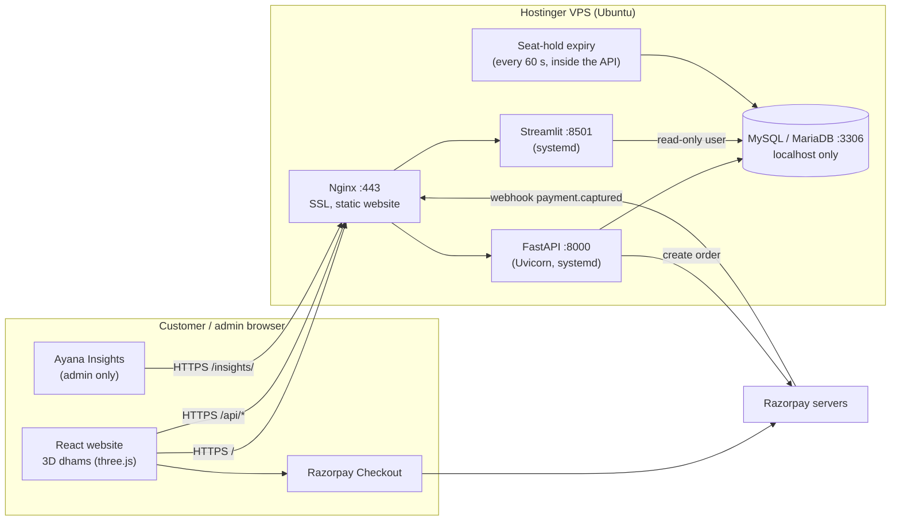
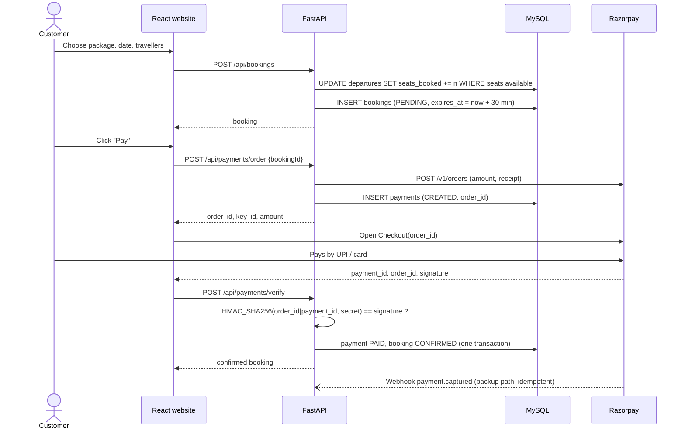
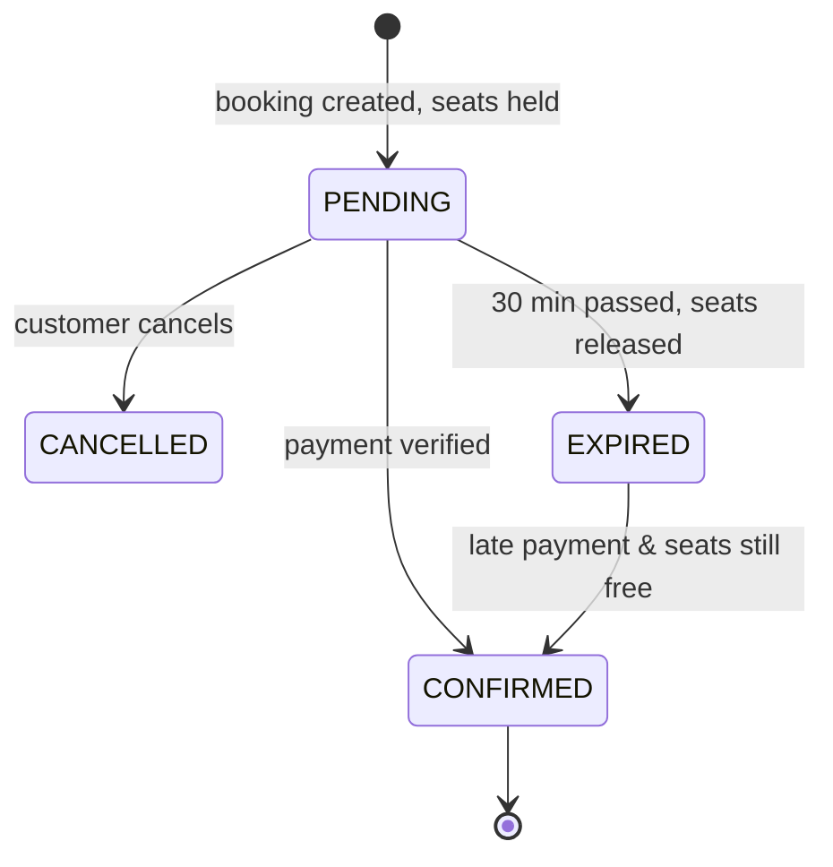

# 2. Architecture – High Level & Low Level Design

## 2.1 Tech stack

| Layer | Choice | Why |
|---|---|---|
| Website | **React 19 + Vite** | Fast dev server, small production build, huge ecosystem |
| 3D | **three.js + React Three Fiber + drei** | Declarative 3D in React: the five dhams, dusk sky, mountains, diyas and the camera fly-through |
| Routing | React Router 7 | Client-side pages |
| Styling | Plain CSS with variables | Easy to edit in Cursor |
| API | **Python 3.12 + FastAPI** | Fast, typed, automatic interactive docs at `/docs`, same language as the analytics |
| Database access | **SQLAlchemy 2** (ORM) + **Alembic** (migrations) | The standard Python way to work with MySQL; schema changes are versioned |
| Validation | **Pydantic** | Every request body and query is checked; errors come back field by field |
| Database | **MySQL 8 / MariaDB 10.6+** | Available on every Hostinger plan; reliable transactions |
| Login | JWT (Bearer token) + bcrypt | Stateless, simple, works for the website and a future Android app |
| Payments | **Razorpay** (Orders API + Checkout + Webhooks) | UPI, cards, net banking, wallets; INR settlement |
| Photos | Pillow | Resize uploads to WEBP (large + thumbnail) |
| Admin analytics | **Streamlit + pandas + Plotly** | Interactive dashboards written in Python, no frontend work |
| App server | Uvicorn (2 workers) under **systemd** | Restarts on crash and reboot |
| Web server | Nginx + Let's Encrypt | HTTPS, gzip, serves the website, proxies `/api` and `/insights` |
| Hosting | **Hostinger KVM VPS** (Ubuntu 24.04) | Full control, everything on one box, cheap |

## 2.2 High level design (HLD)



**Key decisions**
1. **One domain, one server.** `https://ayana.travel` serves the website, `/api` the API, `/insights` the analytics. One SSL certificate.
2. **Database never exposed.** MySQL listens on `127.0.0.1` only. The API uses a read/write user; Insights uses a **read-only** user.
3. **Server is the source of truth for prices.** The browser sends *what* to book; the API calculates *how much*.
4. **Payment confirmed twice, safely.** Checkout callback verifies the signature immediately; the webhook confirms again server-to-server. Both call the same idempotent function.
5. **Seats are held, not oversold.** One conditional SQL `UPDATE` reserves seats. Unpaid bookings expire after 30 minutes.
6. **Same API contract as before.** The API was rewritten from Node.js to Python with identical URLs and JSON, so the website and future apps did not change.

## 2.3 Main user journeys

### Book and pay



### Booking state machine


If a late payment arrives and the seats are gone, the payment is marked `REFUND_PENDING` for the admin.

## 2.4 Low level design (LLD)

### Folder structure

```
.
├── client/                      React website (unchanged by the Python rewrite)
│   └── src/
│       ├── api.js               every API call goes through here
│       ├── three/dham/          3D dham scene
│       ├── pages/               Home, Packages, PackageDetail, Checkout, MyBookings, Auth, Admin, AdminAnalytics
│       └── demo/                in-browser fake API for the shareable preview only
├── api/                         FastAPI
│   ├── app/
│   │   ├── main.py              app, middleware, routers, /uploads, seat-expiry loop
│   │   ├── config.py            settings from .env
│   │   ├── db.py                engine, session per request
│   │   ├── models.py            the 9 tables
│   │   ├── schemas.py           request bodies (Pydantic)
│   │   ├── serializers.py       rows → JSON (camelCase)
│   │   ├── security.py          passwords, JWT, current_user / admin_user, rate limit
│   │   ├── errors.py            {"error", "details"} responses
│   │   ├── routers/             auth, catalog, bookings, payments, admin
│   │   └── services/            booking (seats, confirm), payment (Razorpay), images (Pillow)
│   ├── alembic/versions/        database migrations
│   ├── scripts/                 seed.py, sample_data.py, seed_data.json
│   └── tests/                   end-to-end API tests (pytest)
├── analytics/                   Streamlit "Ayana Insights"
│   ├── Home.py                  overview
│   ├── pages/                   1 Revenue growth · 2 Customer journey · 3 Churn & retention · 4 Segments · 5 Journeys & seats
│   ├── ayana_analytics/         data.py (SQL → pandas), metrics.py (all calculations), auth.py, ui.py
│   └── tests/                   metric definitions checked on hand-made data
├── deploy/                      nginx.conf, ayana-api.service, ayana-insights.service, setup / deploy / backup scripts
└── docs/
```

### API modules

| Module | Responsibility |
|---|---|
| `routers/auth.py` | Register, login, `me`. bcrypt (10 rounds). 7-day JWT. Rate limited (50 / 15 min / IP). |
| `routers/catalog.py` | Public: destinations, categories, package search (filters, sort, pagination), package detail, reviews. |
| `routers/bookings.py` | Create, list mine, get one, cancel unpaid. |
| `routers/payments.py` | `config`, `order`, `verify`, `webhook`. |
| `routers/admin.py` | Stats, analytics, CSV export, package CRUD (soft delete), photos, departures, destinations, bookings. Admin role required. |
| `services/booking.py` | `create_booking` (atomic seat hold), `cancel_pending_booking`, `expire_stale_bookings`, `mark_payment_paid` (idempotent), `refresh_package_rating`. |
| `services/payment.py` | Razorpay order over HTTPS, checkout & webhook HMAC checks (`hmac.compare_digest`), mock mode. |
| `services/images.py` | Validate type/size, fix orientation, save 1600 px + 640 px WEBP, safe delete. |

### Security checklist
- Security headers, CORS limited to `CLIENT_URL`, login rate limit.
- Pydantic validation on every input; SQLAlchemy parameterised queries (no SQL injection).
- Prices calculated on the server; payment signatures verified in constant time.
- Webhook verified on the raw body with a separate secret.
- Mock payments refused when `PAYMENT_MODE=razorpay`.
- `.env` never committed; MySQL bound to localhost; analytics uses a read-only user and admin login.

### Frontend pages

| Route | Page | Notes |
|---|---|---|
| `/` | Home | 3D dhams: hover walks to the door, click flies through it to that dham's journeys |
| `/packages` | Listing | Filters in the URL (shareable) |
| `/packages/:slug` | Detail | Photos, itinerary, reviews, booking panel |
| `/checkout/:id` | Checkout | Seat-hold countdown, Razorpay popup |
| `/my-bookings` | My bookings | Pay, cancel, review |
| `/login`, `/register` | Auth | |
| `/admin` | Admin | Overview / Analytics / Bookings / Packages + link to Ayana Insights |

### 3D scene (client/src/three/dham/)
Five procedural temples (Kedarnath, Kashi Vishwanath, Jagannath Puri, Golden Temple, Rameswaram) at dusk. Hover: camera
walks to the door and the doors open. Click: fly through the doorway into that dham's journeys. Phones: one dham at a
time. Loaded lazily so three.js never blocks the first paint. Details: [06-code-walkthrough.md §6.4](06-code-walkthrough.md).
