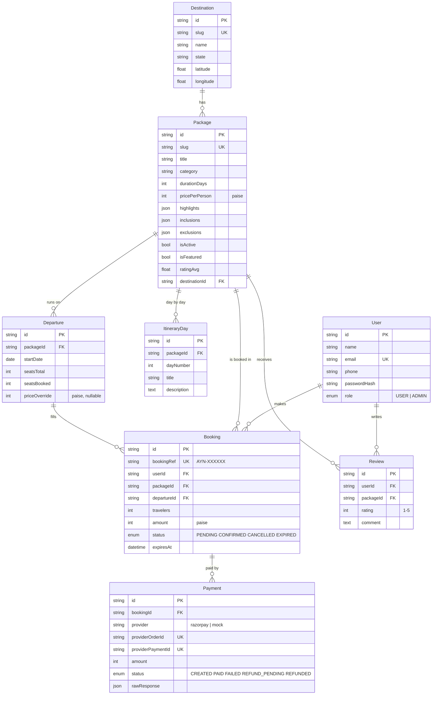

# 3. Database Design

- **Engine:** MySQL 8 or MariaDB 10.6+ (InnoDB, `utf8mb4`).
- **Where it lives:** on the same Hostinger VPS as the API, listening on `127.0.0.1:3306` only (not reachable from the internet). On Hostinger shared/cloud hosting it is the MySQL database you create in hPanel (also `localhost`).
- **Schema source of truth:** [`server/prisma/schema.prisma`](../server/prisma/schema.prisma). Tables are created by `npx prisma migrate deploy`.
- **Money:** stored as integers in paise (₹18,999 = `1899900`) to avoid rounding errors.
- **IDs:** `cuid()` strings (not guessable, safe to show in URLs).

## 3.1 Entity relationship diagram



## 3.2 Tables

| Table | Purpose | Important columns / indexes |
|---|---|---|
| `User` | Customers and admins | `email` unique; `role` |
| `Destination` | Holy places shown on the 3D globe | `slug` unique; `latitude`, `longitude` |
| `Package` | A sellable journey | `slug` unique; index on `category`, `destinationId`, `(isActive,isFeatured)`; denormalised `ratingAvg/ratingCount` for fast listing |
| `ItineraryDay` | Day-by-day plan | unique `(packageId, dayNumber)`; cascades on package delete |
| `Departure` | A dated batch with limited seats | `seatsBooked` includes seats held by pending bookings; optional `priceOverride` for peak dates |
| `Booking` | A customer's reservation | `bookingRef` unique; index `(status, expiresAt)` for the expiry job |
| `Payment` | Each gateway order/attempt | `providerOrderId` unique (idempotency key for verify + webhook) |
| `Review` | Rating after a confirmed booking | unique `(userId, packageId)` – one review per journey |

## 3.3 Consistency rules
- **No overbooking:** `UPDATE Departure SET seatsBooked = seatsBooked + n WHERE id = ? AND seatsBooked + n <= seatsTotal` – if 0 rows change, the booking is refused.
- **Idempotent payments:** `markPaymentPaid` first checks `Payment.status`; a second call (webhook after verify) does nothing.
- **Soft delete:** packages are hidden (`isActive=false`), never deleted, so old bookings stay valid.

## 3.4 Backups
- `deploy/backup-db.sh` dumps the DB with `mysqldump`, gzips it and keeps 14 days. Run it daily from cron (see deployment doc).
- Also enable Hostinger's weekly VPS snapshot in hPanel → VPS → Backups.
- Copy backups off the server weekly (Google Drive / S3) – a backup on the same disk is not a backup.

## 3.5 Useful commands

```bash
cd server
npx prisma studio            # browse/edit data in the browser
npx prisma migrate dev -n x  # create a new migration after editing schema.prisma (local)
npx prisma migrate deploy    # apply migrations (production)
npm run db:seed              # demo data + admin user
```
