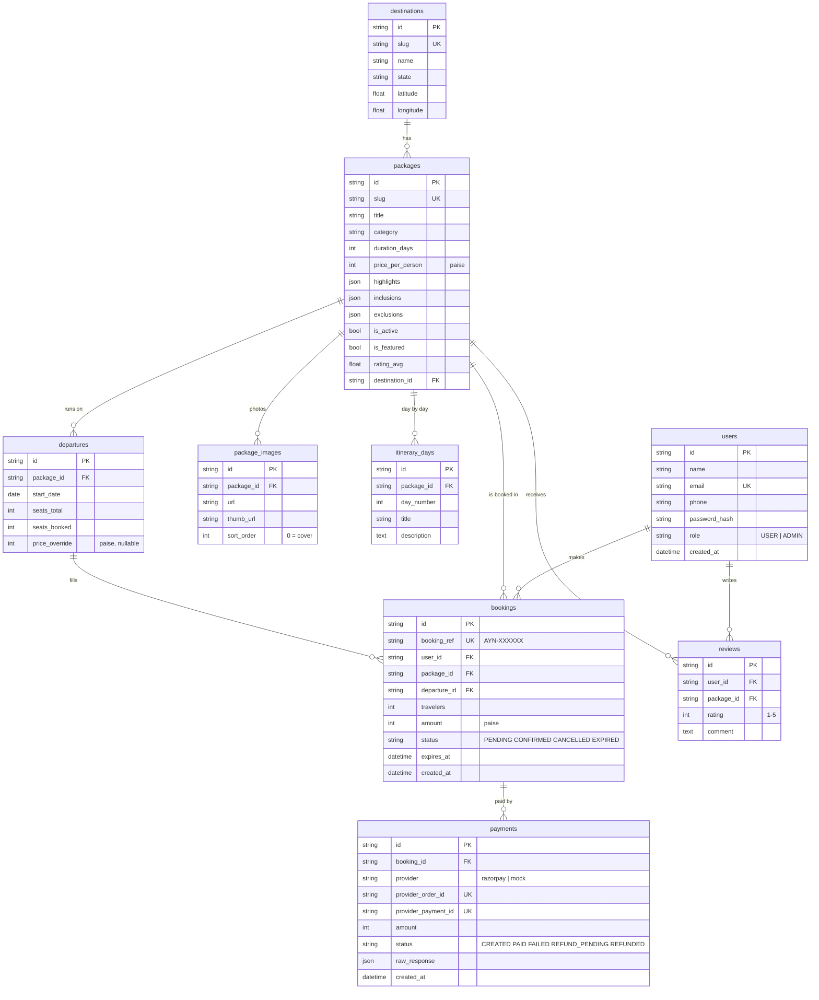

# 3. Database Design

- **Engine:** MySQL 8 or MariaDB 10.6+ (InnoDB, `utf8mb4`).
- **Where it lives:** on the Hostinger VPS, listening on `127.0.0.1:3306` only (not reachable from the internet).
- **Source of truth:** [`api/app/models.py`](../api/app/models.py) (SQLAlchemy). Tables are created and changed by
  **Alembic** migrations in `api/alembic/versions/`.
- **Money:** whole paise (₹18,999 = `1899900`) – no rounding errors.
- **IDs:** random 24-character strings (not guessable, safe in URLs).
- **Times:** UTC. Table and column names are `snake_case` so SQL and the analytics read naturally.

## 3.1 Entity relationship diagram



## 3.2 Tables

| Table | Purpose | Important columns / indexes |
|---|---|---|
| `users` | Customers and admins | `email` unique; `role`; `created_at` = sign-up date (used for funnels) |
| `destinations` | Holy places (the 3D dhams link here by `slug`) | `slug` unique |
| `packages` | A sellable journey | `slug` unique; indexes on `category`, `destination_id`, `(is_active, is_featured)`; `rating_avg/rating_count` stored for fast listing |
| `package_images` | Uploaded photos (large + thumbnail WEBP) | `(package_id, sort_order)`; deleted with the package |
| `itinerary_days` | Day-by-day plan | unique `(package_id, day_number)` |
| `departures` | A dated batch with limited seats | `seats_booked` includes seats held by unpaid bookings; `price_override` for peak dates |
| `bookings` | A customer's reservation | `booking_ref` unique; `(status, expires_at)` for the expiry job |
| `payments` | Each gateway order | `provider_order_id` unique (idempotency key for verify + webhook) |
| `reviews` | Rating after a confirmed booking | unique `(user_id, package_id)` |
| `alembic_version` | Which migration the database is on | managed by Alembic |

## 3.3 Consistency rules
- **No overbooking:** `UPDATE departures SET seats_booked = seats_booked + :n WHERE id = :id AND seats_booked + :n <= seats_total` – 0 rows changed means refused.
- **Idempotent payments:** `mark_payment_paid` locks the payment row and checks its status; a second call does nothing.
- **Soft delete:** packages are hidden (`is_active = 0`), never deleted, so old bookings stay valid.

## 3.4 Users of the database

| MySQL user | Rights | Used by |
|---|---|---|
| `ayana` | all on `ayana` | the API (FastAPI) |
| `ayana_read` | `SELECT` only | Ayana Insights (Streamlit) and anyone doing analysis |

Both are created by `deploy/setup-vps.sh`.

## 3.5 Backups
`deploy/backup-db.sh` dumps the database and zips `api/uploads` every night, keeping 14 days. Also enable Hostinger's
VPS snapshots and copy backups off the server weekly.

## 3.6 Useful commands (inside `api/` with the virtual environment active)

```bash
alembic upgrade head                              # apply all migrations
alembic revision --autogenerate -m "add x"        # after editing app/models.py: create a migration
alembic downgrade -1                              # undo the last migration
python -m scripts.seed                            # demo data + admin user (safe to repeat)
python -m scripts.sample_data                     # sample customers for analytics (never in production)
```
