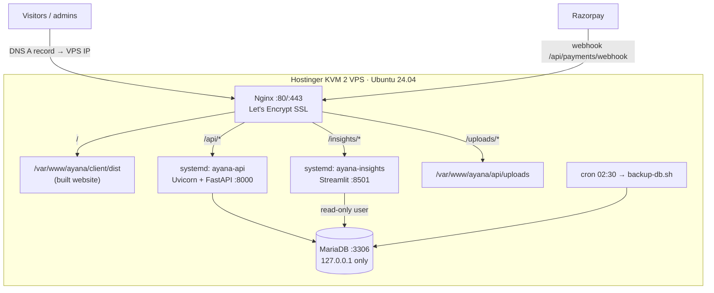

# 5. Hosting on Hostinger (reference)

The step-by-step version for beginners is **[07-cursor-github-hostinger.md](07-cursor-github-hostinger.md)**.
This page is the reference: what runs where and the production settings.

## 5.1 Which Hostinger product?

| Option | Good for | Verdict |
|---|---|---|
| **A. KVM VPS (KVM 2 recommended)** | Python API + Streamlit + MySQL + Nginx on one machine you control | ✅ **Recommended** |
| B. Shared / Business / Cloud web hosting | PHP sites; Python apps and long-running services are not supported the way we need | ❌ Not suitable for FastAPI + Streamlit |

## 5.2 What runs on the VPS



| Piece | Where | Managed by |
|---|---|---|
| Code | `/var/www/ayana` (git clone) | `deploy/deploy.sh` |
| API | `api/.venv`, port 8000 | `deploy/ayana-api.service` (systemd) |
| Insights | `analytics/.venv`, port 8501, URL `/insights/` | `deploy/ayana-insights.service` |
| Website | `client/dist` | built by `deploy.sh`, served by Nginx |
| Database | MariaDB, users `ayana` (read/write) and `ayana_read` | created by `deploy/setup-vps.sh` |
| Nginx site | `/etc/nginx/sites-available/ayana` | copy of `deploy/nginx.conf` |

## 5.3 Production settings

`api/.env`
```env
ENVIRONMENT=production
CLIENT_URL=https://yourdomain.com
DATABASE_URL=mysql+pymysql://ayana:<printed-password>@localhost:3306/ayana
JWT_SECRET=<python -c "import secrets; print(secrets.token_hex(48))">
PAYMENT_MODE=razorpay
RAZORPAY_KEY_ID=rzp_test_xxx        # rzp_live_ after testing
RAZORPAY_KEY_SECRET=xxx
RAZORPAY_WEBHOOK_SECRET=<long random string, same as in the Razorpay dashboard>
ADMIN_EMAIL=you@yourdomain.com
ADMIN_PASSWORD=<strong password>
```

`analytics/.env`
```env
ANALYTICS_DATABASE_URL=mysql+pymysql://ayana_read:<printed-password>@localhost:3306/ayana
```

## 5.4 Razorpay
1. Dashboard → **Account & Settings → API Keys** → test keys → `api/.env` → `sudo systemctl restart ayana-api`.
2. **Webhooks → Add**: `https://yourdomain.com/api/payments/webhook`, secret = `RAZORPAY_WEBHOOK_SECRET`,
   events `payment.captured`, `payment.failed`, `order.paid`.
3. Test with UPI `success@razorpay`, then switch to live keys after KYC.

## 5.5 Operations

| Task | Command (as `ayana` on the VPS) |
|---|---|
| API logs | `journalctl -u ayana-api -f` |
| Insights logs | `journalctl -u ayana-insights -f` |
| Restart | `sudo systemctl restart ayana-api` / `ayana-insights` |
| Health | `curl -s localhost:8000/api/health` |
| Deploy by hand | `cd /var/www/ayana && bash deploy/deploy.sh` |
| Backups | `crontab -e` → `30 2 * * * bash /var/www/ayana/deploy/backup-db.sh >> /var/www/ayana/logs/backup.log 2>&1` |
| Restore a backup | `gunzip -c ayana-DATE.sql.gz \| mysql -u ayana -p ayana` and `tar xzf ayana-uploads-DATE.tgz -C /var/www/ayana/api` |

## 5.6 Go-live checklist
- [ ] `ENVIRONMENT=production`, strong `JWT_SECRET`, `PAYMENT_MODE=razorpay`, live keys
- [ ] Your own admin email/password set **before** the first seed
- [ ] **Never** run `scripts.sample_data` on the server (it refuses in production anyway)
- [ ] HTTPS on `www` and bare domain; `/insights/` asks for the admin login
- [ ] Webhook delivers (Razorpay dashboard shows 200)
- [ ] Nightly backup runs, and a restore was tested once
- [ ] Policy pages live (Terms, Privacy, Refund/Cancellation, Contact)
- [ ] Real photos on every package
