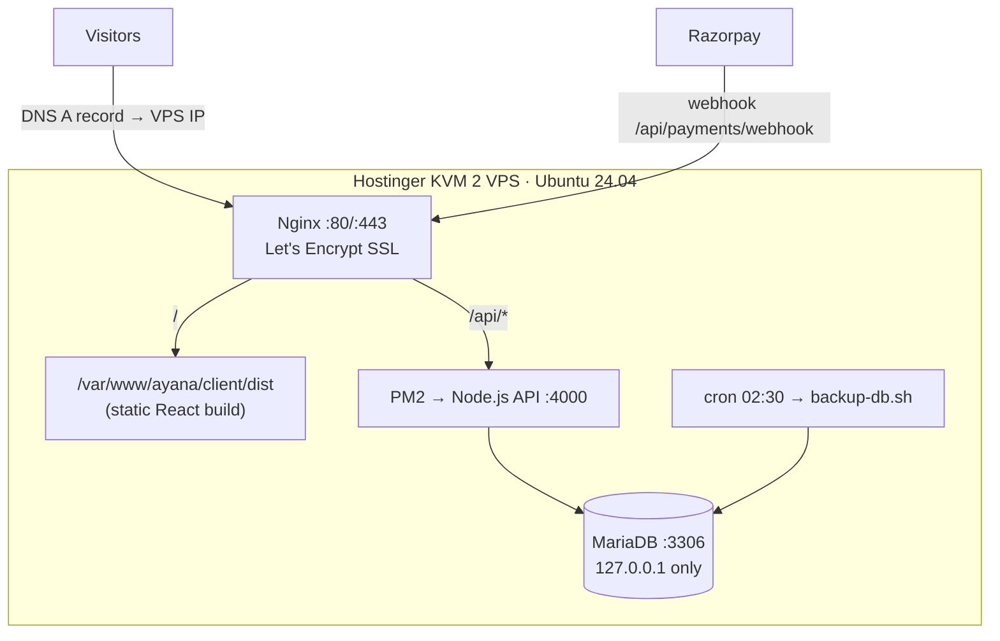

# 5. Hosting on Hostinger

## 5.1 Which Hostinger product?

| Option | Good for | Database | Verdict |
|---|---|---|---|
| **A. KVM VPS (KVM 2 recommended)** | Full Node.js + MySQL control, background jobs, webhooks | MariaDB/MySQL on the same VPS, localhost only | ✅ **Recommended** |
| B. Business / Cloud web hosting with "Node.js apps" in hPanel | Small sites, no Linux admin | hPanel → Databases → MySQL | Works if your plan lists Node.js apps; less control |
| C. Shared hosting without Node.js | PHP sites only | – | ❌ Can't run this API |

Final production picture (Option A):



## 5.2 Step by step (Option A – VPS)

### 1. Buy and set up the VPS
1. hPanel → **VPS** → choose **KVM 2** → OS: **Ubuntu 24.04** (plain OS).
2. Set a root password and **add your SSH key** (hPanel → VPS → Settings → SSH keys).
3. Note the VPS **IP address**.

### 2. Point your domain
hPanel → **Domains** → your domain → **DNS / Nameservers** → edit records:

| Type | Name | Points to | TTL |
|---|---|---|---|
| A | `@` | your VPS IP | 300 |
| A | `www` | your VPS IP | 300 |

(Domain bought elsewhere? Add the same A records at that registrar.) DNS can take up to a few hours.

### 3. Prepare the server (one time)
```bash
ssh root@YOUR_VPS_IP
git clone https://github.com/saurav1231/saurav1231.git /tmp/ayana-setup
bash /tmp/ayana-setup/deploy/setup-vps.sh ayana.travel you@email.com
```
This installs Nginx, MariaDB, Node.js 22, PM2, the firewall, creates the `ayana` database + user and **prints your `DATABASE_URL`** – copy it.

### 4. Get the code on the server
```bash
su - ayana
git clone https://github.com/saurav1231/saurav1231.git /var/www/ayana
cd /var/www/ayana
cp server/.env.example server/.env
nano server/.env
```
Production `server/.env`:
```env
NODE_ENV=production
PORT=4000
CLIENT_URL=https://ayana.travel
DATABASE_URL="mysql://ayana:<printed-password>@localhost:3306/ayana"
JWT_SECRET=<run: node -e "console.log(require('crypto').randomBytes(48).toString('hex'))">
PAYMENT_MODE=razorpay
RAZORPAY_KEY_ID=rzp_test_xxx        # switch to rzp_live_ after testing
RAZORPAY_KEY_SECRET=xxx
RAZORPAY_WEBHOOK_SECRET=<any long random string, same as in Razorpay dashboard>
ADMIN_EMAIL=you@yourdomain.com
ADMIN_PASSWORD=<strong password>
```
The repo is private? Use a GitHub deploy key or `git clone https://<token>@github.com/...`.

### 5. Build, migrate, start
```bash
bash deploy/deploy.sh          # installs, runs migrations, builds React, starts PM2
cd server && npm run db:seed   # first time only: demo packages + admin user
exit                           # back to root
pm2 startup systemd -u ayana --hp /home/ayana   # run the command it prints, so PM2 starts on reboot
```

### 6. Nginx + HTTPS (as root)
```bash
cp /var/www/ayana/deploy/nginx.conf /etc/nginx/sites-available/ayana
sed -i 's/ayana.travel/YOURDOMAIN.com/g' /etc/nginx/sites-available/ayana
ln -sf /etc/nginx/sites-available/ayana /etc/nginx/sites-enabled/ayana
rm -f /etc/nginx/sites-enabled/default
nginx -t && systemctl reload nginx
certbot --nginx -d YOURDOMAIN.com -d www.YOURDOMAIN.com -m you@email.com --agree-tos -n
```
Open `https://YOURDOMAIN.com` – the 3D site should load. `https://YOURDOMAIN.com/api/health` should return `{"ok":true}`.

### 7. Razorpay
1. Dashboard → **Account & Settings → API Keys** → generate test keys → put in `.env` → `pm2 reload ayana-api`.
2. Dashboard → **Webhooks → Add new**: URL `https://YOURDOMAIN.com/api/payments/webhook`, secret = `RAZORPAY_WEBHOOK_SECRET`, events: `payment.captured`, `payment.failed`, `order.paid`.
3. Make a test booking with Razorpay test card / UPI `success@razorpay`.
4. After KYC approval, generate **live** keys, add a live webhook, update `.env`, reload.

### 8. Backups and monitoring
```bash
crontab -e   # as user ayana
30 2 * * * bash /var/www/ayana/deploy/backup-db.sh >> /var/www/ayana/logs/backup.log 2>&1
```
- Turn on hPanel → VPS → **Backups** (weekly snapshots).
- Free uptime alert: UptimeRobot on `https://YOURDOMAIN.com/api/health`.
- Logs: `pm2 logs ayana-api`, `/var/log/nginx/error.log`.

### 9. Shipping updates
Push to GitHub from Cursor, then on the server:
```bash
ssh ayana@YOUR_VPS_IP 'cd /var/www/ayana && bash deploy/deploy.sh'
```

## 5.3 Option B – Hostinger web hosting with Node.js apps
If your Business/Cloud plan shows **Websites → Node.js** (or "Add Node.js app") in hPanel:
1. hPanel → **Databases → MySQL Databases** → create DB + user. Your URL looks like
   `mysql://u123456789_ayana:<pass>@localhost:3306/u123456789_ayana`.
2. Build the frontend on your laptop: `cd client && npm run build` (commit `client/dist` or upload it).
3. Create the Node.js app pointing at the repo/zip, **root = `server`**, start file `src/index.js`, Node 20+.
4. Add the environment variables from `.env.example`, plus `SERVE_CLIENT=true` (Express then serves `client/dist` itself, no Nginx needed).
5. Run `npx prisma migrate deploy` and `npm run db:seed` from the app's terminal / SSH.
6. Point the domain in hPanel and enable the free SSL.

Limits: the seat-expiry job needs the app to stay running (it does on these plans, but it may sleep on the cheapest tiers), and you get less control over Node versions and logs. Move to a VPS when traffic grows.

## 5.4 Go-live checklist
- [ ] `NODE_ENV=production`, strong `JWT_SECRET`, `PAYMENT_MODE=razorpay`, live keys
- [ ] Admin password changed from the seed default
- [ ] HTTPS works on `www` and bare domain
- [ ] Webhook delivers (Razorpay dashboard shows 200)
- [ ] Daily backup runs, and you tested restoring one: `gunzip -c file.sql.gz | mysql -u ayana -p ayana`
- [ ] Policy pages live (Terms, Privacy, Refund/Cancellation, Contact)
- [ ] Real photos added to packages (admin → Edit → Image URL)
