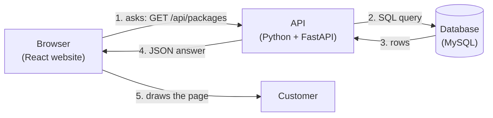
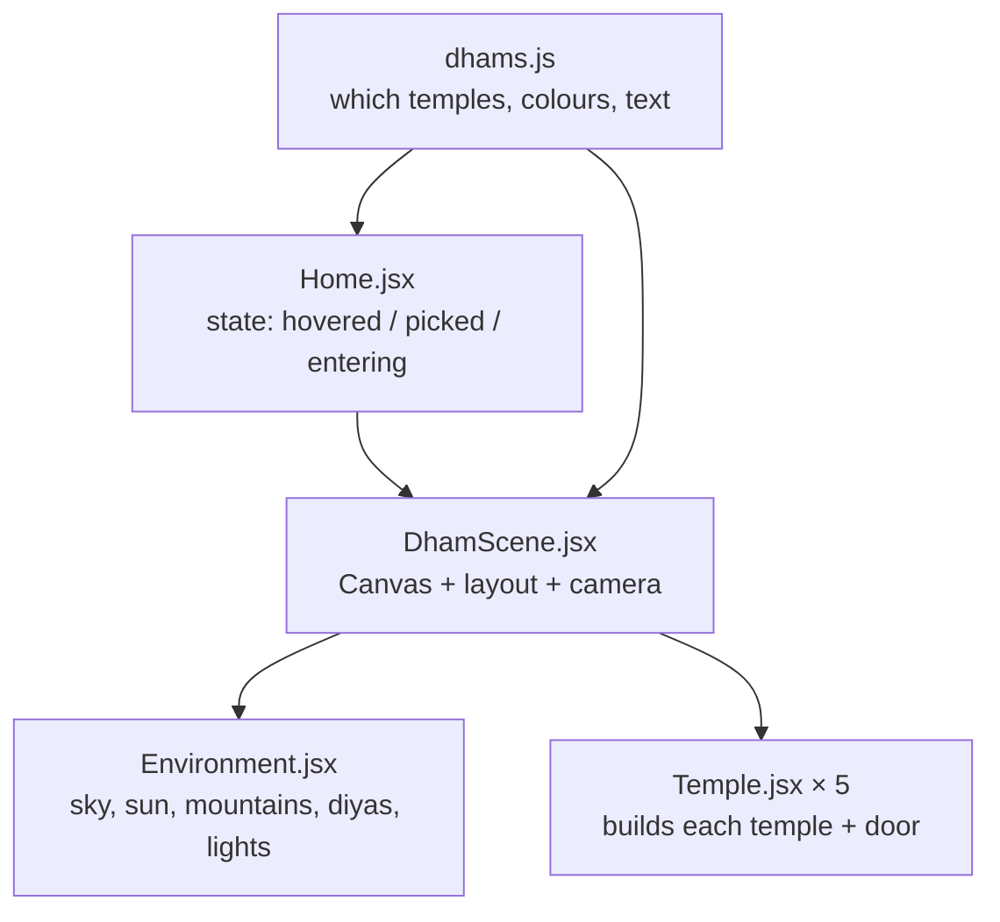

# 6. Code Walkthrough – every file explained

This guide explains the whole Ayana codebase in plain language. Read it top to bottom once;
afterwards use it as a map when you want to change something in Cursor.

---

## 6.0 How the pieces talk to each other



- **Frontend (`client/`)** – what the customer sees. Written in **React** (JavaScript that builds web pages
  from small reusable pieces called *components*). It never talks to the database directly.
- **Backend / API (`api/`)** – a Python program that runs on your server. It receives requests like
  "give me all packages" or "create a booking", checks them, talks to the database, and replies with **JSON**
  (plain data text such as `{ "title": "Kashi Awakening", "price": 1899900 }`).
- **Database (MySQL)** – stores everything permanently in tables (users, packages, bookings, payments…).
- **Analytics (`analytics/`)** – a separate Python app (Streamlit) where admins study customers and revenue.
- **API** – the list of addresses the frontend can call on the backend, e.g. `GET /api/packages`.
  "GET" means *read*, "POST" means *create*, "PUT/PATCH" means *change*, "DELETE" means *remove*.

A few JavaScript words you will see in the website code (Python words are explained in 6.2):

| Word | Meaning |
|---|---|
| `import … from` | load code from another file or library |
| `export` | let other files use this function/component |
| `async` / `await` | "this takes time (database, network) – wait for it, then continue" |
| `const x = …` | give a name to a value |
| `(a, b) => a + b` | a short way to write a function |
| `{ ...obj }` | copy all fields of `obj` |
| `paise` | money is always stored ×100 (₹18,999 = `1899900`) so there are no rounding errors |

---

## 6.1 Project root

| File | What it does |
|---|---|
| `package.json` | Shortcut commands for the website: `npm run dev:client`, `npm run build`, `npm run build:demo`. |
| `README.md` | Quick start. |
| `.gitignore` | Files Git must never upload: `node_modules` and `.venv` (downloaded libraries), `.env` (passwords), `dist` (build output), `uploads`, `logs`. |
| `.cursorrules` | Instructions Cursor's AI reads before editing your code, so it follows the same conventions. |
| `docker-compose.yml` | Starts MySQL on your laptop with `docker compose up -d`. `deploy/mysql-init.sql` also lets the tests create their own `ayana_test` database. |
| `.github/workflows/deploy.yml` | GitHub Actions: on every push it runs the API tests (with a real MySQL), the analytics tests and the website build; on `main` it then logs into your VPS and runs `deploy/deploy.sh`. Explained in [guide 07](07-cursor-github-hostinger.md). |

---

## 6.2 API (backend) – `api/` · Python + FastAPI

### Python words you will see

| Word | Meaning |
|---|---|
| `def name(...):` | a function |
| `async def` / `await` | a function that waits for something slow (network, file upload) without blocking others |
| `class X(Base):` | a blueprint – here, one database table or one kind of request |
| `@router.get("/packages")` | a *decorator*: "run the function below when someone calls GET /api/packages" |
| `Depends(current_user)` | FastAPI fills this argument for you – e.g. "the logged-in user", or "a database session" |
| `str \| None` | a type hint: a text value, or nothing |
| `with SessionLocal() as db:` | open a database session and close it automatically afterwards |
| virtual environment (`.venv`) | a private folder holding this project's Python libraries |

### `api/requirements.txt`
The Python libraries, each pinned to an exact version so every computer installs the same thing:

| Library | Why |
|---|---|
| `fastapi` | the web framework: routes, validation, automatic docs at `/docs` |
| `uvicorn` | the server program that runs FastAPI |
| `SQLAlchemy` + `PyMySQL` | talk to MySQL with Python classes instead of hand-written SQL |
| `alembic` | database migrations (create and change tables safely) |
| `pydantic`, `pydantic-settings`, `email-validator` | check incoming data; read settings from `.env` |
| `bcrypt`, `PyJWT` | scramble passwords one-way; create/check login tokens |
| `httpx` | call Razorpay's API |
| `pillow`, `python-multipart` | receive photo uploads and resize them |
| `pytest` | run the tests |

### `api/.env.example` → copy to `api/.env`
All settings and secrets: `DATABASE_URL`, `JWT_SECRET`, `PAYMENT_MODE` (`mock` / `razorpay`), Razorpay keys,
`UPLOAD_DIR`, `BOOKING_HOLD_MINUTES`, `CLIENT_URL`, first admin email/password. The code contains no passwords.

### `api/app/main.py` – the starting point
1. Creates the FastAPI `app`, registers error handlers, CORS (only your website may call it) and security headers.
2. Mounts the routers under `/api` (auth, catalog, bookings, payments, admin) and the Razorpay webhook.
3. Serves uploaded photos at `/uploads`.
4. On start-up runs `expiry_loop`: every 60 seconds, `expire_stale_bookings()` frees seats of unpaid bookings older than 30 minutes.
5. Optional `SERVE_CLIENT=true`: also serves the built website (for hosting without Nginx).

Run it with `uvicorn app.main:app --reload --port 8000`; open `http://localhost:8000/docs` to try every endpoint.

### `api/app/config.py`
`Settings` reads `.env`, applies defaults and refuses to start if something essential is missing (e.g. `JWT_SECRET`,
or Razorpay keys when `PAYMENT_MODE=razorpay`). `get_settings()` returns one shared copy.

### `api/app/db.py`
Creates the database **engine** (connection pool) and `get_db()`, which gives each request its own session and always
closes it. `Base` is the parent class of all tables.

### `api/app/models.py` – the database tables
Each class is a table; each `mapped_column` is a column:

```python
class Booking(Base):
    __tablename__ = "bookings"
    id: Mapped[str] = mapped_column(String(32), primary_key=True, default=new_id)
    booking_ref: Mapped[str] = mapped_column(String(20), unique=True)   # AYN-7K2P9Q
    user_id: Mapped[str] = mapped_column(ForeignKey("users.id"), index=True)
    amount: Mapped[int] = mapped_column(Integer)                        # paise
    status: Mapped[str] = mapped_column(String(20), default=PENDING)
    user: Mapped[User] = relationship(back_populates="bookings")        # booking.user gives the customer
```
Tables: `users`, `destinations`, `packages`, `package_images`, `itinerary_days`, `departures`, `bookings`, `payments`,
`reviews` ([diagram](03-database.md)). Status words (`PENDING`, `CONFIRMED`, `PAID`…) are constants at the top.

### `api/alembic/` – migrations
`versions/0001_initial_tables.py` creates every table. After you change `models.py`:
`alembic revision --autogenerate -m "what changed"` writes a new file; `alembic upgrade head` applies it (the deploy
script does this on the server automatically).

### `api/app/schemas.py` – what requests must look like
Pydantic classes such as `BookingIn` (package, departure, travellers 1–50, contact name ≥ 2 letters, phone 7–20
characters). The website sends `contactPhone` (camelCase); Python sees `contact_phone`. Invalid input is rejected
before your code runs, with a message per field.

### `api/app/serializers.py` – what answers look like
Turns rows into the exact JSON the website expects (`pricePerPerson`, ISO dates like `2026-11-06T00:00:00.000Z`).
`unit_price` picks the date's special price if set, else the package price.

### `api/app/security.py`
- `hash_password` / `check_password` – bcrypt.
- `create_token(user)` – JWT with the user id and role, valid 7 days.
- `current_user` – reads `Authorization: Bearer <token>`, checks it, loads the user, else 401.
- `admin_user` – only `role = ADMIN`, else 403.
- `auth_rate_limit` – at most 50 login/register attempts per IP per 15 minutes.

### `api/app/errors.py`
`HttpError` plus shortcuts (`bad_request` 400, `unauthorized` 401, `forbidden` 403, `not_found` 404, `conflict` 409).
Handlers turn every error – including validation errors and duplicate entries – into `{"error": "...", "details": {...}}`.
Unexpected errors are logged and the customer sees a polite message (never internal details).

### `api/app/routers/` – the endpoints
Each function is one endpoint. The pattern everywhere:

```python
@router.post("", status_code=201)
def create(data: BookingIn, user: User = Depends(current_user), db: Session = Depends(get_db)):
    booking = create_booking(db, user, data)          # the business rule lives in services/
    return {"booking": booking_out(...)}               # FastAPI turns the dict into JSON
```

| File | Endpoints |
|---|---|
| `auth.py` | `POST /auth/register`, `POST /auth/login`, `GET /auth/me` |
| `catalog.py` | `GET /destinations` (+ counts for the dham chips), `GET /categories`, `GET /packages` (search, filters, sort, pages), `GET /packages/{slug}` (photos, itinerary, future dates, reviews), `POST /packages/{slug}/reviews` (only after a confirmed booking) |
| `bookings.py` | `POST /bookings`, `GET /bookings/me`, `GET /bookings/{id}` (owner or admin), `POST /bookings/{id}/cancel` |
| `payments.py` | `GET /payments/config`, `POST /payments/order`, `POST /payments/verify`, the webhook |
| `admin.py` | `GET /admin/stats`, `GET /admin/analytics`, `GET /admin/export/bookings.csv`, package create/update/hide, photo upload/reorder/rename/delete, departures, destinations, bookings list |

### `api/app/services/` – the important business rules
**`booking.py`**
- `hold_seats` – one SQL statement: `UPDATE departures SET seats_booked = seats_booked + :n WHERE … AND seats_booked + :n <= seats_total`.
  The database checks and updates in one step, so two people can never take the last seat.
- `create_booking` – finds package and date, **calculates the price on the server**, holds seats, saves a PENDING
  booking expiring in 30 minutes – all in one transaction.
- `cancel_pending_booking`, `expire_stale_bookings` – mark unpaid bookings CANCELLED / EXPIRED and give seats back.
- `mark_payment_paid` – used by both `/verify` and the webhook; locks the payment row; if already handled does nothing.
  Expired booking but seats still free → confirmed anyway; sold out meanwhile → payment `REFUND_PENDING`.
- `refresh_package_rating` – recalculates the average stars.

**`payment.py`**
- `create_gateway_order` – mock order id, or a real `POST https://api.razorpay.com/v1/orders`.
- `verify_checkout_signature` – Razorpay signs `order_id|payment_id` with your secret (HMAC-SHA256); we compute the
  same and compare with `hmac.compare_digest`. A fake payment cannot match.
- `verify_webhook_signature` – same for webhooks, using the webhook secret on the raw body.

**`images.py`**
- `read_uploads` – up to 12 files, JPG/PNG/WEBP/AVIF, 15 MB each.
- `save_package_image` – Pillow turns the photo the right way up (phone photos), saves a 1600 px and a 640 px WEBP in
  `uploads/packages/<id>/`. A 6 MB photo becomes ~200 KB.
- `delete_image_files` – removes both files, never outside the uploads folder.

### `api/scripts/`
- `seed.py` – reads `seed_data.json` (12 destinations, 11 journeys with itineraries), adds 4 future dates per journey
  and the admin from `.env`. Safe to run again.
- `sample_data.py` – about 700 sample customers over two years: seasonality, growth, repeat pilgrims who move from one
  dham to the next, people who stop coming and people who come back, reviews. Emails end in `@example.com`.
  Refuses to run in production.

### `api/tests/`
`conftest.py` builds a fresh `ayana_test` database. `test_api.py` checks the whole flow through real HTTP calls:
catalog, login errors, booking + mock payment, seat limits and cancel, expiry, Razorpay signatures and webhook replay,
admin (stats, analytics, CSV, packages, photos). Run `pytest` inside `api/`.

---

## 6.3 Frontend – `client/`

### `client/index.html`, `vite.config.js`, `package.json`
- `index.html` – the single HTML page; React fills `<div id="root">`. Also loads the two fonts.
- `vite.config.js` – **Vite** is the tool that runs the dev server and builds the final files. In development it forwards
  `/api` and `/uploads` to the FastAPI server on `localhost:8000`, so the website and API feel like one site.
- `package.json` – React, React Router (pages), three.js + React Three Fiber + drei (3D).
  Commands: `npm run dev`, `npm run build` (makes `dist/` for the server), `npm run build:demo` (the shareable preview).
- `.env.example` – `VITE_API_URL` (only if the API is on another domain) and `VITE_INSIGHTS_URL` (where the admin's Insights button points). `.env.demo` turns on preview mode.

### `client/src/main.jsx`
Starts React: wraps the app in the **Router** (which page to show for which URL) and the **AuthProvider**
(who is logged in). In the preview build it uses an in-memory router because the preview can't change the address bar.

### `client/src/App.jsx`
The list of pages (`/`, `/packages`, `/packages/:slug`, `/checkout/:id`, `/my-bookings`, `/login`, `/register`, `/admin`).
`Protected` sends visitors to login if needed and keeps non-admins out of `/admin`.

### `client/src/api.js`
- `api(path, options)` – every call to the backend goes through here. Adds the login token, turns errors into readable
  messages. In the preview build it calls the in-browser fake backend instead.
- `apiUpload` – sends photos as `multipart/form-data`.
- `tokenStore` – remembers the login token in the browser (`localStorage`).
- `mediaUrl`, `formatPrice` (₹ Indian format), `formatDate`.

### `client/src/useApi.js`
A **hook** (reusable React logic): `const { data, loading, error, reload } = useApi('/packages', { category })`.
It loads data when the page opens and again whenever the query changes.

### `client/src/context/AuthContext.jsx`
Keeps the logged-in user for the whole app. On start, if a token exists it asks `/auth/me`. Provides `login`,
`register`, `logout` to any page via `useAuth()`.

### `client/src/components/`
- **`Layout.jsx`** – top navigation, footer, and the preview banner. Every page renders inside it.
- **`ui.jsx`** – small reusable pieces:
  `Spinner`, `ErrorBox`, `Cover` (first photo, else typed image URL, else generated gradient artwork),
  `Stars`, `PackageCard` (the card that tilts in 3D following the mouse), `ConfirmButton` (tap twice to confirm),
  `StatusPill` (coloured booking status).

### `client/src/pages/`
| File | What the customer/admin sees |
|---|---|
| `Home.jsx` | The 3D dham hero (see 6.4), journey types, featured journeys, "why Ayana". |
| `Packages.jsx` | Listing with filters. Filters live in the URL (`?category=Pilgrimage&maxPrice=20000`) so links can be shared. Heading changes to "Journeys to Kedarnath" when you arrive from a temple. |
| `PackageDetail.jsx` | Cover photo, details, **photo gallery with full-screen viewer**, day-by-day timeline, included/not included, reviews, and the booking panel (date, travellers, contact → creates a booking → checkout). |
| `Checkout.jsx` | Booking summary, 30-minute countdown, **Pay** button. Mock mode confirms instantly; Razorpay mode loads Razorpay's checkout script, opens the payment popup, sends the result to `/payments/verify`. |
| `MyBookings.jsx` | Customer's bookings: pay pending ones, cancel unpaid ones, write a review after a confirmed trip. |
| `Auth.jsx` | Login and register forms; return to the page you came from (`?next=`). |
| `Admin.jsx` | Tabs: Overview, Analytics, Bookings, Packages. Package editor (text fields; itinerary as "Title \| details" per line), **Photos manager** (upload, make cover, reorder, delete), add departure dates, hide packages. |
| `AdminAnalytics.jsx` | Period switch (3/6/12 months), headline numbers, revenue-by-month chart with hover details, top journeys, revenue by destination, booking outcomes, seats filled in the next 60 days, CSV export. |

### `client/src/styles.css`
All styling. Colours and fonts are variables at the top (`--saffron`, `--gold`, `--serif`…) – change them once and
the whole site follows. Sections are labelled (`/* hero */`, `/* cards */`, `/* admin */`, `/* analytics */`…).
The `@media (max-width: 900px)` block contains the phone layout.

### `client/src/demo/` – the shareable preview only
`demoBackend.js` imitates every API endpoint inside the browser (data in `localStorage`, sample bookings, simulated
payments, photos resized in the browser). `demo-data.json` is a copy of the seed packages. **The real site never uses these files.**

---

## 6.4 The 3D dham scene – `client/src/three/dham/`



- **`dhams.js`** – the list of five dhams: `slug` (must match a destination in the database), name, region,
  one-line description, `style` (`nagara`, `gopuram` or `golden`) and colours. **To add a sixth dham, add an entry here.**
- **`Temple.jsx`** – builds temples from simple 3D shapes:
  - `buildNagara` – North Indian style: stone platform with steps, square sanctum, curved **shikhara** spire
    (a profile curve spun around, with ring bands), amalaka disc, golden kalash, waving saffron flag, porch (mandapa)
    with pyramid roof. Used for Kedarnath (grey stone), Kashi Vishwanath (gold), Jagannath Puri (tall white + blue Nila Chakra).
  - `buildGopuram` – South Indian gateway tower: six painted tiers with sculpture niches, barrel-vault crown, row of kalashas (Rameswaram).
  - `buildGolden` – Golden Temple: marble walkway around a blue pool, causeway, golden sanctum, lotus dome, corner chhatris.
  - `Door` – golden frame, two wooden doors on hinges, warm light behind. When the temple is focused, `open` goes from 0 to 1:
    the doors swing open and the light brightens.
  - `Temple` – handles mouse hover/click and dims the other temples when one is chosen.
- **`Environment.jsx`** – the dusk world: a sky drawn by a small shader (indigo → plum → saffron with a glowing sun),
  stars, 16 low-poly snow peaks (same shape every visit), a stone courtyard, 26 flickering diyas, floating embers, warm lights.
- **`DhamScene.jsx`** – places the five temples on a curve facing you and runs the **camera**:
  - *Overview*: sees all temples, drifts slightly with your mouse.
  - *Hover a temple*: glides to stand in front of its door; doors open (after 0.45 s without hover it returns).
  - *Click*: flies through the doorway; `Home.jsx` fades the screen to gold and opens `/packages?destination=<slug>`.
  - *Phones*: one temple at a time; arrows/chips switch temples; tap again or press **Enter** to go in.
  Movement uses `damp` (smooth easing) every frame, so it never jumps.
- `Home.jsx` decides phone vs desktop (`useCompact`), shows the dham info card and chips, and plays the gold fade.

**Want real 3D models later?** A 3D artist can model each temple in Blender and export `.glb` files. Replace the
`build…` function for that dham with `useGLTF('/models/kedarnath.glb')` from drei – the camera, door and hover logic stay the same.

---

## 6.5 Deployment files – `deploy/`

| File | What it does |
|---|---|
| `setup-vps.sh` | Run once on a fresh VPS as root: installs Nginx, MariaDB, Python, Node 22 (to build the website), firewall; creates the database, the `ayana` (read/write) and `ayana_read` (read-only) users and the `ayana` system user; prints both database addresses. |
| `deploy.sh` | Every release: `git pull`, Python packages for API and Insights, `alembic upgrade head`, website build, restart both services. GitHub Actions runs it automatically. |
| `ayana-api.service` | systemd service: runs Uvicorn with 2 workers on `127.0.0.1:8000`, restarts it if it stops, starts it after a reboot. |
| `ayana-insights.service` | systemd service: runs Streamlit on `127.0.0.1:8501` under the path `/insights`. |
| `nginx.conf` | Nginx site: serves the website, sends `/api/` to FastAPI and `/insights/` to Streamlit (with WebSocket support), serves `/uploads/` photos from disk, caches assets, allows 60 MB uploads. Certbot adds HTTPS. |
| `backup-db.sh` | Nightly: dumps the database and zips `api/uploads` into `~/backups`, keeps 14 days. |
| `mysql-init.sql` | Local Docker only: lets the app user create the test database. |

---

## 6.6 What happens when a customer books (all files together)

1. `PackageDetail.jsx` → `api('/bookings', POST)` → `routers/bookings.py` → `BookingIn` checks the input →
   `services/booking.create_booking` → `hold_seats` SQL → `bookings` row (PENDING).
2. Browser opens `/checkout/:id` → `Checkout.jsx` → **Pay** → `POST /payments/order` → `services/payment.create_gateway_order`
   → Razorpay → `payments` row (CREATED).
3. Razorpay popup → customer pays by UPI → `handler` → `POST /payments/verify` → signature check
   → `mark_payment_paid` → booking CONFIRMED, payment PAID.
4. Razorpay also calls `/api/payments/webhook` → same function → nothing to do (already confirmed).
5. Admin sees it in **Admin → Overview / Bookings / Analytics** at once, and in **Ayana Insights** within 10 minutes
   (or immediately with *Refresh data*).

---

## 6.7 Ayana Insights – `analytics/` · Python + Streamlit

**Streamlit** turns a Python script into a web page: every `st.something(...)` line draws something (a title, a number,
a chart, a table). When the admin changes a filter, the script runs again from the top with the new values.

| File | What it does |
|---|---|
| `requirements.txt` | streamlit, pandas (tables of data), plotly (charts), SQLAlchemy + PyMySQL, bcrypt, python-dotenv, pytest |
| `.env.example` → `.env` | `ANALYTICS_DATABASE_URL` – the **read-only** database user. If empty, uses `api/.env` |
| `.streamlit/config.toml` | Dark theme in Ayana colours; no usage statistics sent anywhere |
| `Home.py` | The **Overview** page: headline numbers vs the previous period, plain-language highlights, revenue trend, customers by status, links to the other pages |
| `pages/1_Revenue_growth.py` | Revenue per period with 3-period average, growth vs previous and vs last year, **growth accounting** (new / won back / spent more / spent less / did not travel), new vs returning revenue, rebounds after a dip, revenue by destination |
| `pages/2_Customer_journey.py` | Funnel from sign-up to 3+ trips, what happens to bookings, second chances, **flow diagram of which dham pilgrims visit next**, journey type to journey type heatmap, timing histograms, sign-ups vs first trips |
| `pages/3_Churn_and_retention.py` | Status counts, churn rate per period, lost vs won back, **cohort heatmap** (do first-time pilgrims come back), **who to call this week** with CSV download |
| `pages/4_Customer_segments.py` | RFM scores and segments with suggested actions and downloadable lists |
| `pages/5_Journeys_and_seats.py` | Revenue by journey, bookings not completed, how full departures were, upcoming departures |
| `ayana_analytics/data.py` | Runs five SQL queries and returns pandas tables: customers, bookings, **orders** (= paid bookings with who/what/when), departures, reviews. Cached for 10 minutes; *Refresh data* clears it |
| `ayana_analytics/metrics.py` | **Every calculation**, as plain functions (no Streamlit inside), so they can be tested: `revenue_by_period`, `growth_accounting`, `new_vs_returning`, `customer_table`, `churn_by_period`, `cohort_repeat`, `rfm`, `funnel`, `destination_flows`, `transitions`, `timing`, `retry_after_failure`, `occupancy`, `package_health` |
| `ayana_analytics/auth.py` | `require_admin()` – login form checked against the `users` table (role ADMIN, bcrypt). Every page calls it first |
| `ayana_analytics/ui.py` | Shared look: chart colours (a tested colour-blind-safe palette; green/amber/red only for customer status), ₹ formatting in lakh/crore, chart styling, and the sidebar **filters** (period, group by month/quarter/year, churn window, destinations, journey types) that stay set when you change page |
| `tests/test_metrics.py` | Small hand-made data with known answers, checking growth, growth accounting, statuses, churn, cohorts, segments, flows and the funnel |

The exact definition of every number is in **[11-streamlit-analytics.md](11-streamlit-analytics.md)**.
