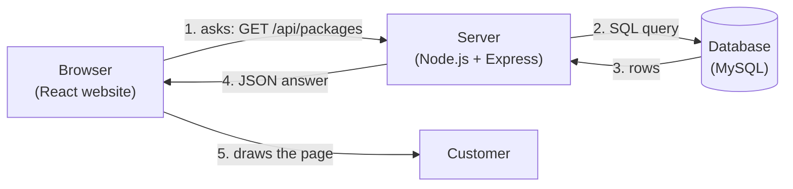
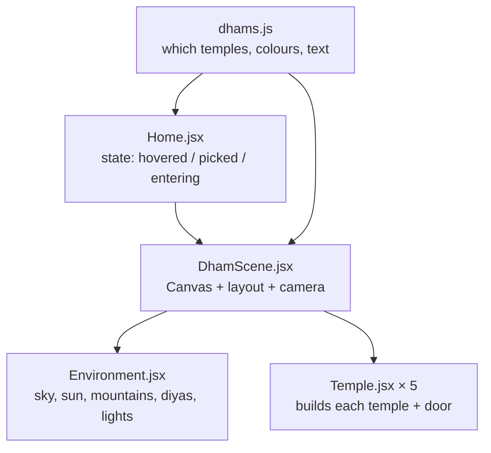

# 6. Code Walkthrough – every file explained

This guide explains the whole Ayana codebase in plain language. Read it top to bottom once;
afterwards use it as a map when you want to change something in Cursor.

---

## 6.0 How the pieces talk to each other



- **Frontend (`client/`)** – what the customer sees. Written in **React** (JavaScript that builds web pages
  from small reusable pieces called *components*). It never talks to the database directly.
- **Backend (`server/`)** – a program that runs on your server. It receives requests like
  "give me all packages" or "create a booking", checks them, talks to the database, and replies with **JSON**
  (plain data text such as `{ "title": "Kashi Awakening", "price": 1899900 }`).
- **Database (MySQL)** – stores everything permanently in tables (users, packages, bookings, payments…).
- **API** – the list of addresses the frontend can call on the backend, e.g. `GET /api/packages`.
  "GET" means *read*, "POST" means *create*, "PUT/PATCH" means *change*, "DELETE" means *remove*.

A few words you will see everywhere:

| Word | Meaning |
|---|---|
| `import … from` | load code from another file or library |
| `export` | let other files use this function/component |
| `async` / `await` | "this takes time (database, network) – wait for it, then continue" |
| `const x = …` | give a name to a value |
| `(a, b) => a + b` | a short way to write a function |
| `{ ...obj }` | copy all fields of `obj` |
| `paise` | money is always stored ×100 (₹18,999 = `1899900`) so there are no rounding errors |

---

## 6.1 Project root

| File | What it does |
|---|---|
| `package.json` | Shortcut commands for the whole project: `npm run setup` (install both apps), `npm run dev:server`, `npm run dev:client`, `npm run build`. |
| `README.md` | Quick start. |
| `.gitignore` | Files Git must never upload: `node_modules` (downloaded libraries), `.env` (passwords), `dist` (build output), `logs`. |
| `.cursorrules` | Instructions Cursor's AI reads before editing your code, so it follows the same conventions. |
| `docker-compose.yml` | Starts a MySQL database on your laptop with one command (`docker compose up -d`) if you don't want to install MySQL. |
| `.github/workflows/deploy.yml` | GitHub Actions: on every push to `main`, it checks the code builds, then logs into your Hostinger VPS and runs `deploy/deploy.sh`. Explained in [guide 07](07-cursor-github-hostinger.md). |

---

## 6.2 Backend – `server/`

### `server/package.json`
Lists the libraries the API uses and its commands:

| Library | Why |
|---|---|
| `express` | the web server framework – receives requests, sends responses |
| `@prisma/client` + `prisma` | talk to MySQL with JavaScript instead of raw SQL; also creates tables (migrations) |
| `bcryptjs` | scrambles passwords one-way before saving (we never store real passwords) |
| `jsonwebtoken` | creates the login "token" (a signed pass the browser shows on each request) |
| `zod` | checks that incoming data is valid (email looks like an email, travellers ≥ 1…) |
| `razorpay` | creates payment orders with Razorpay |
| `multer` + `sharp` | receive uploaded photos and resize them |
| `helmet`, `cors`, `express-rate-limit` | security headers, which websites may call the API, limit login attempts |
| `morgan` | prints one log line per request |
| `dotenv` | reads settings from the `.env` file |

Commands: `npm run dev` (start with auto-restart), `npm run db:setup` (create tables + demo data),
`npm run db:sample` (fake bookings for analytics, development only), `npm run db:studio` (browse data in a web page).

### `server/.env.example` → copy to `server/.env`
All settings and secrets in one place, so the code itself contains no passwords:
`DATABASE_URL` (where MySQL is), `JWT_SECRET` (key that signs login tokens), `PAYMENT_MODE` (`mock` or `razorpay`),
Razorpay keys, `UPLOAD_DIR` (photo folder), `BOOKING_HOLD_MINUTES` (30), admin email/password for the first seed.

### `server/prisma/schema.prisma` – the database design
Each `model` becomes a table. Read it like this:

```prisma
model Booking {
  id          String  @id @default(cuid())   // unique id, generated automatically
  bookingRef  String  @unique                // AYN-7K2P9Q, shown to customers
  userId      String
  user        User    @relation(fields: [userId], references: [id])  // link to the customer
  amount      Int                            // paise
  status      BookingStatus @default(PENDING)
  ...
}
```

Tables: `User`, `Destination`, `Package`, `PackageImage`, `ItineraryDay`, `Departure`, `Booking`, `Payment`, `Review`.
Full diagram in [03-database.md](03-database.md). When you change this file, run `npx prisma migrate dev -n what_changed`;
Prisma writes the SQL into `prisma/migrations/` and updates the database.

### `server/prisma/seed.js`
Fills an empty database with 12 destinations, 11 packages (with itineraries and 4 departure dates each) and the admin
user. It uses `upsert` (update if it exists, otherwise insert), so running it twice is safe.

### `server/prisma/sample-bookings.js`
Creates 20 fake customers and ~190 bookings spread over the last 12 months so the Analytics tab has data while you
build. It refuses to run when `NODE_ENV=production`.

### `server/src/index.js` – the starting point
1. Builds the app (`createApp()`), starts listening on port 4000.
2. Every 60 seconds runs `expireStaleBookings()` – unpaid bookings older than 30 minutes become `EXPIRED` and their seats are freed.
3. On shutdown (Ctrl+C or PM2 restart) closes the database connection cleanly.

### `server/src/app.js` – wiring
Order matters here; each `app.use` is a layer every request passes through:
1. `helmet` (security headers) → `cors` (only your website may call the API) → `morgan` (logging).
2. The **Razorpay webhook** route is registered *before* the JSON parser because the signature must be checked on the exact raw bytes Razorpay sent.
3. `express.json()` turns request bodies into JavaScript objects.
4. Rate limit on `/api/auth` (50 attempts / 15 min per IP) against password guessing.
5. `/uploads` serves photo files from disk.
6. Route files: `/api/auth`, `/api` (catalog), `/api/bookings`, `/api/payments`, `/api/admin`.
7. Optional `SERVE_CLIENT=true`: the API also serves the built website (for Hostinger plans without Nginx).
8. `errorHandler` last – turns any thrown error into a clean JSON message.

### `server/src/config.js`
Reads `.env`, applies defaults, and stops the server at startup if something essential is missing
(e.g. `JWT_SECRET`, or Razorpay keys when `PAYMENT_MODE=razorpay`). Warns loudly if mock payments are on in production.

### `server/src/lib/` – small helpers
| File | What it does |
|---|---|
| `prisma.js` | creates the single database connection everyone shares |
| `errors.js` | `HttpError` plus shortcuts: `badRequest` (400), `unauthorized` (401), `forbidden` (403), `notFound` (404), `conflict` (409) |
| `validate.js` | `validate(schema, data)` – runs a zod check, throws a 400 with the field problems if it fails |
| `serialize.js` | shapes rows for the API: removes `passwordHash` from users, calculates `seatsLeft` and the per-date price |

### `server/src/middleware/`
- **`auth.js`**
  - `signToken(user)` → a JWT containing the user id and role, valid 7 days.
  - `requireAuth` → reads `Authorization: Bearer <token>`, verifies the signature, loads the user, else replies 401.
  - `requireAdmin` → only lets `role = ADMIN` continue, else 403.
- **`error.js`** → converts errors to JSON: our `HttpError`s keep their status; duplicate values (Prisma code P2002) → 409; "not found" (P2025) → 404; photo too large → 400; anything unexpected → logged and a generic 500 (never leaks internals).

### `server/src/routes/` – the API endpoints
Each file is a mini-router. Pattern used everywhere:

```js
router.post('/', async (req, res) => {
  const data = validate(createSchema, req.body);   // 1. check input
  const booking = await createBooking(req.user, data); // 2. do the work
  res.status(201).json({ booking });               // 3. reply
});
```

| File | Endpoints and logic |
|---|---|
| `auth.js` | `POST /register` (checks email unused, hashes password, returns token), `POST /login` (compares hash), `GET /me` |
| `catalog.js` | Public pages: `GET /destinations` (+ package counts, used by the dham chips), `GET /categories`, `GET /packages` (search, filters, sort, pagination – the filter object is built step by step from the query string), `GET /packages/:slug` (detail with photos, itinerary, future departures, reviews), `POST /packages/:slug/reviews` (only if you have a CONFIRMED booking; then recalculates the average rating) |
| `bookings.js` | All need login. `POST /` create, `GET /me` my bookings, `GET /:id` one booking (owner or admin only), `POST /:id/cancel` |
| `payments.js` | `GET /config`, `POST /order` (creates a Razorpay order for a PENDING booking, saves a `Payment` row), `POST /verify` (checks Razorpay's signature, then confirms), `razorpayWebhook` (Razorpay calls this directly; signature checked; confirms even if the customer closed the browser) |
| `admin.js` | Admin only. `GET /stats`, `GET /analytics` (SQL group-by queries per month, package, destination, category; booking outcomes; repeat customers; seats filled), `GET /export/bookings.csv`, package create/update/hide, photo upload/reorder/delete, departures, destinations, bookings list |

### `server/src/services/` – the important business rules
**`bookingService.js`**
- `holdSeats` – one SQL statement: `UPDATE Departure SET seatsBooked = seatsBooked + n WHERE … AND seatsBooked + n <= seatsTotal`.
  The database does the check and the update in one step, so two people can never grab the last seat at the same time.
- `createBooking` – finds package and date, **calculates the price on the server** (never trusts the browser),
  holds seats, creates a `PENDING` booking that expires in 30 minutes. All inside a transaction (all-or-nothing).
- `cancelPendingBooking` / `expireStaleBookings` – mark unpaid bookings `CANCELLED` / `EXPIRED` and give seats back.
- `markPaymentPaid` – called by both `/verify` and the webhook. If already handled, does nothing (safe to call twice).
  Normal case: booking → `CONFIRMED`, payment → `PAID`. If the booking had expired, it tries to re-hold seats;
  if the date sold out meanwhile, the payment is marked `REFUND_PENDING` for the admin.
- `refreshPackageRating` – recalculates average stars after a review.

**`paymentService.js`**
- In `mock` mode creates fake order ids; in `razorpay` mode calls `razorpay.orders.create`.
- `verifyCheckoutSignature` – Razorpay signs `order_id|payment_id` with your secret key (HMAC-SHA256). We compute the same
  and compare using a timing-safe comparison. If someone fakes a payment, the signatures won't match.
- `verifyWebhookSignature` – same idea for webhooks, using the webhook secret.

**`imageService.js`**
- `uploadImages` – accepts up to 12 JPG/PNG/WEBP/AVIF files, 15 MB each, held in memory briefly.
- `savePackageImage` – `sharp` rotates the photo the right way up (phone photos), then saves a 1600 px and a 640 px
  WEBP copy in `uploads/packages/<packageId>/`. A 6 MB phone photo becomes ~200 KB, so pages load fast.
- `deleteImageFiles` – removes both files when a photo is deleted.

---

## 6.3 Frontend – `client/`

### `client/index.html`, `vite.config.js`, `package.json`
- `index.html` – the single HTML page; React fills `<div id="root">`. Also loads the two fonts.
- `vite.config.js` – **Vite** is the tool that runs the dev server and builds the final files. In development it forwards
  `/api` and `/uploads` to `localhost:4000`, so the website and API feel like one site.
- `package.json` – React, React Router (pages), three.js + React Three Fiber + drei (3D).
  Commands: `npm run dev`, `npm run build` (makes `dist/` for the server), `npm run build:demo` (the shareable preview).
- `.env.example` – `VITE_API_URL`, only needed if the API is on a different domain. `.env.demo` turns on preview mode.

### `client/src/main.jsx`
Starts React: wraps the app in the **Router** (which page to show for which URL) and the **AuthProvider**
(who is logged in). In the preview build it uses an in-memory router because the preview can't change the address bar.

### `client/src/App.jsx`
The list of pages (`/`, `/packages`, `/packages/:slug`, `/checkout/:id`, `/my-bookings`, `/login`, `/register`, `/admin`).
`Protected` sends visitors to login if needed and keeps non-admins out of `/admin`.

### `client/src/api.js`
- `api(path, options)` – every call to the backend goes through here. Adds the login token, turns errors into readable
  messages. In the preview build it calls the in-browser fake backend instead.
- `apiUpload` – sends photos as `multipart/form-data`.
- `tokenStore` – remembers the login token in the browser (`localStorage`).
- `mediaUrl`, `formatPrice` (₹ Indian format), `formatDate`.

### `client/src/useApi.js`
A **hook** (reusable React logic): `const { data, loading, error, reload } = useApi('/packages', { category })`.
It loads data when the page opens and again whenever the query changes.

### `client/src/context/AuthContext.jsx`
Keeps the logged-in user for the whole app. On start, if a token exists it asks `/auth/me`. Provides `login`,
`register`, `logout` to any page via `useAuth()`.

### `client/src/components/`
- **`Layout.jsx`** – top navigation, footer, and the preview banner. Every page renders inside it.
- **`ui.jsx`** – small reusable pieces:
  `Spinner`, `ErrorBox`, `Cover` (first photo, else typed image URL, else generated gradient artwork),
  `Stars`, `PackageCard` (the card that tilts in 3D following the mouse), `ConfirmButton` (tap twice to confirm),
  `StatusPill` (coloured booking status).

### `client/src/pages/`
| File | What the customer/admin sees |
|---|---|
| `Home.jsx` | The 3D dham hero (see 6.4), journey types, featured journeys, "why Ayana". |
| `Packages.jsx` | Listing with filters. Filters live in the URL (`?category=Pilgrimage&maxPrice=20000`) so links can be shared. Heading changes to "Journeys to Kedarnath" when you arrive from a temple. |
| `PackageDetail.jsx` | Cover photo, details, **photo gallery with full-screen viewer**, day-by-day timeline, included/not included, reviews, and the booking panel (date, travellers, contact → creates a booking → checkout). |
| `Checkout.jsx` | Booking summary, 30-minute countdown, **Pay** button. Mock mode confirms instantly; Razorpay mode loads Razorpay's checkout script, opens the payment popup, sends the result to `/payments/verify`. |
| `MyBookings.jsx` | Customer's bookings: pay pending ones, cancel unpaid ones, write a review after a confirmed trip. |
| `Auth.jsx` | Login and register forms; return to the page you came from (`?next=`). |
| `Admin.jsx` | Tabs: Overview, Analytics, Bookings, Packages. Package editor (text fields; itinerary as "Title \| details" per line), **Photos manager** (upload, make cover, reorder, delete), add departure dates, hide packages. |
| `AdminAnalytics.jsx` | Period switch (3/6/12 months), headline numbers, revenue-by-month chart with hover details, top journeys, revenue by destination, booking outcomes, seats filled in the next 60 days, CSV export. |

### `client/src/styles.css`
All styling. Colours and fonts are variables at the top (`--saffron`, `--gold`, `--serif`…) – change them once and
the whole site follows. Sections are labelled (`/* hero */`, `/* cards */`, `/* admin */`, `/* analytics */`…).
The `@media (max-width: 900px)` block contains the phone layout.

### `client/src/demo/` – the shareable preview only
`demoBackend.js` imitates every API endpoint inside the browser (data in `localStorage`, sample bookings, simulated
payments, photos resized in the browser). `demo-data.json` is a copy of the seed packages. **The real site never uses these files.**

---

## 6.4 The 3D dham scene – `client/src/three/dham/`



- **`dhams.js`** – the list of five dhams: `slug` (must match a destination in the database), name, region,
  one-line description, `style` (`nagara`, `gopuram` or `golden`) and colours. **To add a sixth dham, add an entry here.**
- **`Temple.jsx`** – builds temples from simple 3D shapes:
  - `buildNagara` – North Indian style: stone platform with steps, square sanctum, curved **shikhara** spire
    (a profile curve spun around, with ring bands), amalaka disc, golden kalash, waving saffron flag, porch (mandapa)
    with pyramid roof. Used for Kedarnath (grey stone), Kashi Vishwanath (gold), Jagannath Puri (tall white + blue Nila Chakra).
  - `buildGopuram` – South Indian gateway tower: six painted tiers with sculpture niches, barrel-vault crown, row of kalashas (Rameswaram).
  - `buildGolden` – Golden Temple: marble walkway around a blue pool, causeway, golden sanctum, lotus dome, corner chhatris.
  - `Door` – golden frame, two wooden doors on hinges, warm light behind. When the temple is focused, `open` goes from 0 to 1:
    the doors swing open and the light brightens.
  - `Temple` – handles mouse hover/click and dims the other temples when one is chosen.
- **`Environment.jsx`** – the dusk world: a sky drawn by a small shader (indigo → plum → saffron with a glowing sun),
  stars, 16 low-poly snow peaks (same shape every visit), a stone courtyard, 26 flickering diyas, floating embers, warm lights.
- **`DhamScene.jsx`** – places the five temples on a curve facing you and runs the **camera**:
  - *Overview*: sees all temples, drifts slightly with your mouse.
  - *Hover a temple*: glides to stand in front of its door; doors open (after 0.45 s without hover it returns).
  - *Click*: flies through the doorway; `Home.jsx` fades the screen to gold and opens `/packages?destination=<slug>`.
  - *Phones*: one temple at a time; arrows/chips switch temples; tap again or press **Enter** to go in.
  Movement uses `damp` (smooth easing) every frame, so it never jumps.
- `Home.jsx` decides phone vs desktop (`useCompact`), shows the dham info card and chips, and plays the gold fade.

**Want real 3D models later?** A 3D artist can model each temple in Blender and export `.glb` files. Replace the
`build…` function for that dham with `useGLTF('/models/kedarnath.glb')` from drei – the camera, door and hover logic stay the same.

---

## 6.5 Deployment files – `deploy/`

| File | What it does |
|---|---|
| `setup-vps.sh` | Run once on a fresh VPS as root: installs Nginx, MariaDB, Node 22, PM2, firewall; creates the database and the `ayana` user; prints your `DATABASE_URL`. |
| `deploy.sh` | Run for every release: `git pull`, install API, apply database migrations, build the website, restart the API with PM2. GitHub Actions runs this automatically. |
| `ecosystem.config.cjs` | Tells PM2 how to run the API (name `ayana-api`, production mode, restart if memory > 400 MB, log files). |
| `nginx.conf` | Nginx site: serves the built website, sends `/api/` to Node, serves `/uploads/` photos from disk, caches assets, allows 60 MB uploads. Certbot adds HTTPS to it. |
| `backup-db.sh` | Daily: dumps the database and zips the photos folder into `~/backups`, deletes backups older than 14 days. |

---

## 6.6 What happens when a customer books (all files together)

1. `PackageDetail.jsx` → `api('/bookings', POST)` → `routes/bookings.js` → `validate` → `bookingService.createBooking`
   → `holdSeats` SQL → `Booking` row (PENDING).
2. Browser opens `/checkout/:id` → `Checkout.jsx` → **Pay** → `POST /payments/order` → `paymentService.createGatewayOrder`
   → Razorpay → `Payment` row (CREATED).
3. Razorpay popup → customer pays by UPI → `handler` → `POST /payments/verify` → signature check
   → `markPaymentPaid` → Booking CONFIRMED, Payment PAID.
4. Razorpay also calls `/api/payments/webhook` → same function → nothing to do (already confirmed).
5. Admin sees it instantly in **Admin → Overview / Bookings / Analytics**.
