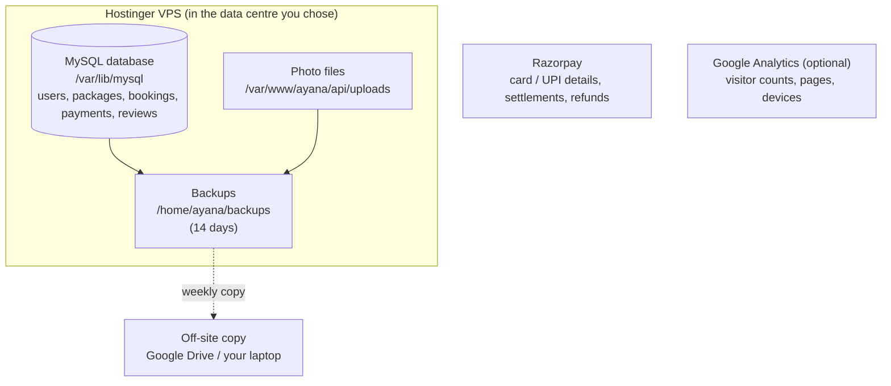

# 8. Your data: where it lives, how the admin sees it, and analytics

## 8.1 Where every piece of data is stored



| Data | Where | Notes |
|---|---|---|
| Customers (name, email, phone, hashed password, sign-up date) | MySQL → `users` | Passwords are one-way hashed; nobody, including you, can read them |
| Packages, destinations, itineraries, dates, seats | MySQL → `packages`, `destinations`, `itinerary_days`, `departures` | Edited in Admin → Packages |
| Bookings | MySQL → `bookings` | Contact name/phone, travellers, amount, status, created time |
| Payments | MySQL → `payments` | Order id, payment id, amount, status. **Card/UPI details never touch your server** – Razorpay keeps them |
| Reviews | MySQL → `reviews` | |
| Photos | Disk → `api/uploads/packages/<id>/` | Paths saved in `package_images` |
| Money received | Razorpay Dashboard | Settlements to your bank (usually T+2 days), refunds, disputes |

## 8.2 Three ways the admin looks at the data

### a) Admin panel in the website (daily work) – `https://yourdomain.com/admin`
- **Overview** – revenue, confirmed/pending bookings, customers, live packages, latest bookings.
- **Analytics** – quick numbers: revenue by month, top journeys, destinations, booking outcomes, seats filled, plus
  **Export bookings to Excel (CSV)** and a button to open Ayana Insights.
- **Bookings** – every booking with customer email/phone, journey, date, travellers, amount, status.
- **Packages** – create/edit journeys, **upload photos**, add departure dates and seats, hide old packages.

### b) Ayana Insights (deep analysis) – `https://yourdomain.com/insights/`
A separate Python **Streamlit** app, signed in with the same admin email and password. It answers:

| Page | Questions it answers |
|---|---|
| **Overview** | How are we doing vs the previous period? What changed? How many customers are active, at risk, lost? |
| **Revenue growth & regrowth** | Revenue by month/quarter/year, growth vs previous period and vs last year, **where growth came from** (new pilgrims, pilgrims won back, people spending more or less, people who did not travel), new vs returning revenue, rebounds after a dip |
| **How customers move** | Sign-up → booking → paid → 2nd trip → 3rd trip funnel; what happens to bookings; who paid after a failed booking; **which dham pilgrims visit next** (flow diagram); journey type to journey type; days from sign-up to booking, between trips, booked ahead |
| **Churn & retention** | Active / at risk / lost customers; churn rate per period; lost vs won back; **do first-time pilgrims come back** (cohort heatmap); **who to call this week** (downloadable list) |
| **Customer segments** | Champions, Loyal, New pilgrims, Promising, Can't lose them, At risk, Hibernating – with a suggested action each and downloadable lists |
| **Journeys & seats** | Revenue by journey, share of bookings not completed, how full departures were, upcoming departures |

Full guide, including every definition: **[11-streamlit-analytics.md](11-streamlit-analytics.md)**.

### c) Excel / Google Sheets / Razorpay
- Admin → Analytics → **Export bookings to Excel (CSV)**, and every list in Insights has a **Download** button.
- Razorpay Dashboard: payments, settlements, refunds (Payments → select → Issue refund), disputes.

### d) Raw tables (advanced)
Never open MySQL to the internet. Use an **SSH tunnel** – a private pipe through your SSH login:
```bash
ssh -L 3307:127.0.0.1:3306 ayana@<VPS IP>
```
While that window is open, connect DBeaver or TablePlus (free) to `localhost:3307` with the read-only user
`ayana_read` from `analytics/.env`.

## 8.3 The quick analytics tab in the website
These numbers come from `GET /api/admin/analytics` (`api/app/routers/admin.py`), which runs SQL `GROUP BY` queries on
`bookings` and `payments`. For anything deeper, open Insights.

## 8.4 More tools when you grow

| Need | Tool | How |
|---|---|---|
| Visitors, traffic sources, which pages people leave | **Google Analytics 4** (free) | Paste the GA4 tag into `client/index.html`; mark "purchase" as a conversion |
| Marketing attribution | UTM links + GA4 | `?utm_source=instagram&utm_campaign=kedarnath` on every ad link |
| Accounting | CSV export → Tally / Zoho Books | Monthly |
| New charts | Ayana Insights | Add a function to `analytics/ayana_analytics/metrics.py` and a block to a page – ask Cursor using guide 11 as context |

Handy SQL (DBeaver, read-only user):
```sql
-- Revenue per month (₹)
SELECT DATE_FORMAT(created_at,'%Y-%m') AS month, SUM(amount)/100 AS revenue_inr
FROM payments WHERE status = 'PAID' GROUP BY month ORDER BY month;

-- Customers who booked more than once
SELECT u.name, u.email, COUNT(*) AS trips FROM bookings b JOIN users u ON u.id = b.user_id
WHERE b.status = 'CONFIRMED' GROUP BY u.id HAVING trips > 1 ORDER BY trips DESC;

-- How far ahead people book (days)
SELECT AVG(DATEDIFF(d.start_date, b.created_at)) AS avg_days_ahead
FROM bookings b JOIN departures d ON d.id = b.departure_id WHERE b.status = 'CONFIRMED';
```

## 8.5 Adding your real photos

1. **Send them to me in this chat** (attach the images and say which package/dham each belongs to), or
2. **Upload them yourself**: Admin → Packages → **Photos (0)** → **+ Add photos** (several at once). The first photo is
   the cover; use **Make cover** and ← → to reorder.

Photo tips: landscape, at least 1600 px wide, JPG/PNG/WEBP up to 15 MB. The API shrinks and converts them automatically.
Use photos you own or have rights to – temple trusts sometimes restrict photography inside sanctums.

## 8.6 Keeping customer data safe and legal

- India's **Digital Personal Data Protection Act, 2023** applies: publish a privacy policy saying what you collect
  (name, email, phone, booking details) and why; collect only what you need; delete a customer's data on request
  (except what tax law requires); report serious breaches. Have your CA/lawyer review it.
- Insights shows customer phone numbers for follow-up calls – only give admin accounts to staff who need them, one
  account per person (set `role` to `ADMIN` in `users`).
- The analytics app reads with a **read-only** database user, so a mistake there can never change or delete data.
- Backups: the nightly script + Hostinger snapshots + a weekly copy off the server.
