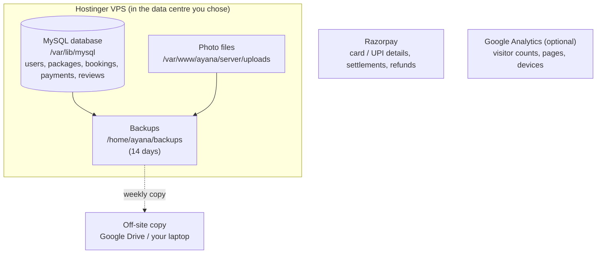

# 8. Your data: where it lives, how the admin sees it, and analytics

## 8.1 Where every piece of data is stored



| Data | Where | Notes |
|---|---|---|
| Customers (name, email, phone, hashed password) | MySQL → `User` | Passwords are one-way hashed; nobody, including you, can read them |
| Packages, destinations, itineraries, dates, seats | MySQL → `Package`, `Destination`, `ItineraryDay`, `Departure` | Edited in Admin → Packages |
| Bookings | MySQL → `Booking` | Contact name/phone, travellers, amount, status |
| Payments | MySQL → `Payment` | Order id, payment id, amount, status. **Card/UPI details never touch your server** – Razorpay keeps them |
| Reviews | MySQL → `Review` | |
| Photos | Disk → `server/uploads/packages/<id>/` | Paths saved in `PackageImage` |
| Money received | Razorpay Dashboard | Settlements to your bank (usually T+2 days), refunds, disputes |

## 8.2 How the admin looks at the data

### a) Admin panel (daily use) – `https://yourdomain.com/admin`
- **Overview** – total revenue, confirmed/pending bookings, customers, live packages, latest bookings.
- **Analytics** – see 8.3.
- **Bookings** – every booking with customer email/phone, journey, date, travellers, amount, status; filter by status.
- **Packages** – create/edit journeys, **upload photos**, add departure dates and seats, hide old packages.

### b) Excel / Google Sheets
Admin → Analytics → **Export bookings to Excel (CSV)** downloads every booking. Open it in Excel, or Google Sheets →
File → Import. Good for accounts, GST filing and sharing with your team.

### c) Razorpay Dashboard
Payments, settlements to your bank, refunds (Payments → select → Issue refund), disputes, GST invoices for Razorpay's fees.

### d) Looking at raw tables (advanced)
Never open MySQL to the internet. Use an **SSH tunnel** – a private pipe through your SSH login:
```bash
# on your laptop
ssh -L 3307:127.0.0.1:3306 ayana@<VPS IP>
```
While that window is open, connect a database app (DBeaver or TablePlus, both free) to `localhost:3307` with the
database user from `server/.env`. Or run Prisma Studio on the server and tunnel port 5555:
`ssh -L 5555:127.0.0.1:5555 ayana@<VPS IP>` then `cd /var/www/ayana/server && npx prisma studio` and open http://localhost:5555.

**Give analysts a read-only user** (as root on the VPS: `mysql`):
```sql
CREATE USER 'ayana_read'@'localhost' IDENTIFIED BY 'a-long-password';
GRANT SELECT ON ayana.* TO 'ayana_read'@'localhost';
```

## 8.3 Analytics built into the admin panel

Admin → **Analytics** (switch 3 / 6 / 12 months):

| Block | Question it answers |
|---|---|
| Revenue, Paid bookings, Travellers | How much business did we do? |
| Avg. booking | Are people booking bigger groups / costlier journeys? |
| Booked → paid | Of people who started a booking, how many paid? Low = price shock, payment trouble, or trust issues on checkout |
| Repeat customers | How many paying customers came back for a second journey |
| Revenue by month (hover for details) | Seasonality – plan departures and ad spend around peaks (e.g. Char Dham season, Shravan, winter yoga) |
| Top journeys by revenue | Which packages to promote, which to drop |
| Revenue by destination | Which dhams to add more dates/vendors for |
| What happened to bookings | Started → paid / not paid in time / cancelled |
| Seats filled · next 60 days | Which departures need marketing push now |

These come from `GET /api/admin/analytics` (`server/src/routes/admin.js`), which runs SQL `GROUP BY` queries on the
`Booking` and `Payment` tables. Want a new number? Ask Cursor: "add bookings by state of the customer to the analytics endpoint and tab".

## 8.4 More analytics when you grow

| Need | Tool | How |
|---|---|---|
| Visitors, traffic sources, which pages people leave | **Google Analytics 4** (free) | Create a GA4 property → paste its tag into `client/index.html` → mark "purchase" as a conversion |
| Drag-and-drop dashboards on your own data | **Metabase** (free, open source) | On the VPS: `docker run -d -p 127.0.0.1:3000:3000 metabase/metabase`, connect it to MySQL with the read-only user, open it through an SSH tunnel (`ssh -L 3000:127.0.0.1:3000 ...`) |
| Marketing attribution | UTM links + GA4 | Use `?utm_source=instagram&utm_campaign=kedarnath` on every ad link |
| Accounting | CSV export → Tally/Zoho Books | Monthly |

Handy SQL (run in DBeaver/Metabase):
```sql
-- Revenue per month (₹)
SELECT DATE_FORMAT(createdAt,'%Y-%m') month, SUM(amount)/100 revenue_inr
FROM Payment WHERE status='PAID' GROUP BY month ORDER BY month;

-- Customers who booked more than once
SELECT u.name, u.email, COUNT(*) trips FROM Booking b JOIN User u ON u.id=b.userId
WHERE b.status='CONFIRMED' GROUP BY u.id HAVING trips > 1 ORDER BY trips DESC;

-- How far ahead people book (days)
SELECT AVG(DATEDIFF(d.startDate, b.createdAt)) avg_days_ahead
FROM Booking b JOIN Departure d ON d.id=b.departureId WHERE b.status='CONFIRMED';
```

## 8.5 Adding your real photos

Two ways:
1. **Send them to me in this chat** (attach the images and tell me which package/dham each belongs to). I'll add them to
   the demo data and the preview.
2. **Upload them yourself** (this is the normal way once live): Admin → Packages → **Photos (0)** on a package →
   **+ Add photos** → pick several at once. The first photo is the cover on cards; use **Make cover** and ← → to reorder.

Photo tips: landscape (wider than tall), at least 1600 px wide, JPG/PNG/WEBP up to 15 MB. The server shrinks and
converts them automatically. Use photos you own or have rights to – temple trusts sometimes restrict photography inside sanctums.

## 8.6 Keeping customer data safe and legal

- India's **Digital Personal Data Protection Act, 2023** applies: publish a privacy policy that says what you collect
  (name, email, phone, booking details) and why; collect only what you need; delete a customer's data if they ask
  (except what tax law requires you to keep); report serious breaches. Have your CA/lawyer review it.
- Only admins can see customer details. Don't share admin logins – create a separate admin account per staff member
  (change their `role` to `ADMIN` in the `User` table).
- Backups: the daily script + Hostinger weekly snapshots + a weekly copy off the server.
