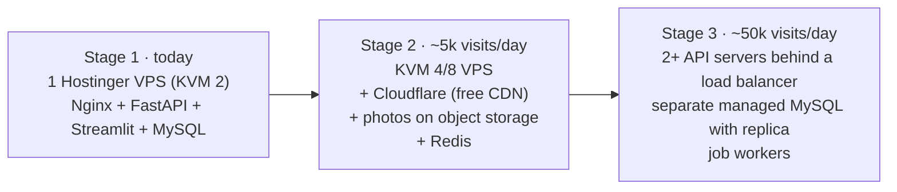

# 9. Growing Ayana: interface, API, database and servers

Today Ayana is **one company selling its own journeys**. "Expanding the network" usually means three things, in this order:

1. **More journeys and places** (more dhams, states, countries, languages) – small changes.
2. **Partner operators** – local tour operators, ashrams, hotels list their packages on Ayana; you take a commission. This turns Ayana into a true **multi-vendor marketplace** – the biggest change.
3. **More traffic** – thousands of visitors a day, Android/iOS apps – server changes.

---

## 9.1 Interface changes as you expand

| Stage | What the customer sees | What changes in code |
|---|---|---|
| More dhams | More temples in the 3D scene, more chips | Add entries to `client/src/three/dham/dhams.js`. Beyond ~7 temples, switch the scene to "rings": Char Dham / 12 Jyotirlingas / Buddhist circuit, each a small arc (group field in `dhams.js`) |
| States & circuits | "Explore Uttarakhand", "Char Dham circuit" pages | New `Region` table + `/regions/:slug` page reusing the listing |
| Hindi & regional languages | Language switch in the menu | `react-i18next` for UI text; `PackageTranslation` table for package content (9.3) |
| Partner operators | "Operated by Shivam Travels ★4.7" on cards; operator profile page | `Vendor` table + vendor badge in `PackageCard` |
| Vendor portal | Operators log in at `/partner` to manage *their* packages, dates, photos, bookings | Copy of the admin Packages/Bookings tabs, filtered by `vendorId` |
| Better booking | Traveller names/ages per seat, coupons, pay 25 % now, room sharing, add-ons (helicopter, pony) | `Traveler`, `Coupon`, `AddOn` tables; checkout steps |
| Trust & support | WhatsApp support button, live booking status, PDF voucher & GST invoice | Notification service, PDF generation |
| Content | Blog / pilgrimage guides for Google search | `Article` table or a headless CMS |

---

## 9.2 API changes

1. **Versioning before the mobile app**: keep today's routes as `v1` by serving them at both `/api` and `/api/v1`.
   Breaking changes go to `/api/v2` so older app versions keep working.
   ```python
   # api/app/main.py - mount the same routers twice
   for prefix in ("/api", "/api/v1"):
       api = APIRouter(prefix=prefix)
       api.include_router(auth.router)   # ...same for catalog, bookings, payments, admin
       app.include_router(api)
   ```
2. **Roles**: `USER`, `VENDOR`, `ADMIN`, `SUPPORT`. Add a `vendor_user` dependency in `api/app/security.py` next to `admin_user`.
3. **New route groups**

| Routes | Purpose |
|---|---|
| `GET /api/v1/vendors/:slug` | public operator profile |
| `/api/v1/vendor/*` | operator portal: own packages, departures, photos, bookings, payouts (every query filtered by the logged-in user's `vendor_id`) |
| `POST /api/v1/admin/vendors/:id/approve` | you approve operators and their packages before they go live |
| `POST /api/v1/coupons/validate` | check a coupon at checkout |
| `POST /api/v1/admin/bookings/:id/refund` | Razorpay Refunds API + `Refund` row |
| `POST /api/v1/devices` | mobile push-notification tokens |
| `POST /api/v1/auth/refresh` | refresh tokens so the app stays logged in |
| `POST /api/v1/auth/otp` | phone OTP login (MSG91/Twilio) – most Indian customers prefer it |
| `GET /api/v1/search?q=` | fast search (MySQL FULLTEXT first, Meilisearch later) |

4. **Payments for vendors**: use **Razorpay Route** – the customer pays Ayana, Razorpay automatically transfers the
   operator's share to their linked account and keeps your commission. Store each transfer in a `Payout` row.
5. **Background jobs**: move the seat-expiry timer, emails, WhatsApp messages and PDF invoices to a job queue
   (BullMQ + Redis) once you run more than one API process.

---

## 9.3 Database changes (SQLAlchemy models + Alembic)

Add these to `api/app/models.py` step by step. After each step run
`alembic revision --autogenerate -m "add vendors"` and `alembic upgrade head`. Existing data keeps working:
new columns start as optional (`| None`).

```python
class Vendor(Base):                      # partner tour operator / ashram / hotel
    __tablename__ = "vendors"
    id: Mapped[str] = mapped_column(String(32), primary_key=True, default=new_id)
    slug: Mapped[str] = mapped_column(String(191), unique=True)
    name: Mapped[str] = mapped_column(String(200))
    gstin: Mapped[str | None] = mapped_column(String(20))
    phone: Mapped[str] = mapped_column(String(20))
    email: Mapped[str] = mapped_column(String(191))
    status: Mapped[str] = mapped_column(String(20), default="PENDING")   # PENDING, APPROVED, SUSPENDED
    commission_pct: Mapped[float] = mapped_column(Numeric(5, 2), default=12)
    razorpay_account_id: Mapped[str | None] = mapped_column(String(50))  # linked account for Razorpay Route
    created_at: Mapped[datetime] = mapped_column(Timestamp, default=utcnow)

# User gets:    vendor_id: Mapped[str | None] = mapped_column(ForeignKey("vendors.id"))
#               role can also be "VENDOR" or "SUPPORT"
# Package gets: vendor_id: Mapped[str | None] = mapped_column(ForeignKey("vendors.id"))
#               status: Mapped[str] = mapped_column(String(20), default="PUBLISHED")  # DRAFT, IN_REVIEW, PUBLISHED

class Region(Base):                      # state or circuit, e.g. Uttarakhand, Char Dham
    __tablename__ = "regions"
    id: Mapped[str] = mapped_column(String(32), primary_key=True, default=new_id)
    slug: Mapped[str] = mapped_column(String(191), unique=True)
    name: Mapped[str] = mapped_column(String(120))
    parent_id: Mapped[str | None] = mapped_column(ForeignKey("regions.id"))
# Destination gets: region_id

class Traveler(Base):                    # one row per person on a booking
    __tablename__ = "travelers"
    id: Mapped[str] = mapped_column(String(32), primary_key=True, default=new_id)
    booking_id: Mapped[str] = mapped_column(ForeignKey("bookings.id"))
    name: Mapped[str] = mapped_column(String(120))
    age: Mapped[int] = mapped_column(Integer)
    id_proof_last4: Mapped[str | None] = mapped_column(String(4))   # never store full Aadhaar numbers

class Coupon(Base):
    __tablename__ = "coupons"
    id: Mapped[str] = mapped_column(String(32), primary_key=True, default=new_id)
    code: Mapped[str] = mapped_column(String(40), unique=True)
    percent_off: Mapped[int | None] = mapped_column(Integer)
    amount_off: Mapped[int | None] = mapped_column(Integer)          # paise
    valid_till: Mapped[datetime] = mapped_column(Timestamp)
    max_uses: Mapped[int | None] = mapped_column(Integer)
    used: Mapped[int] = mapped_column(Integer, default=0)

class Refund(Base):
    __tablename__ = "refunds"
    id: Mapped[str] = mapped_column(String(32), primary_key=True, default=new_id)
    payment_id: Mapped[str] = mapped_column(ForeignKey("payments.id"))
    amount: Mapped[int] = mapped_column(Integer)
    razorpay_refund_id: Mapped[str | None] = mapped_column(String(100), unique=True)
    reason: Mapped[str] = mapped_column(String(300))
    status: Mapped[str] = mapped_column(String(20), default="PENDING")

class Payout(Base):                      # commission split per booking for a vendor
    __tablename__ = "payouts"
    id: Mapped[str] = mapped_column(String(32), primary_key=True, default=new_id)
    vendor_id: Mapped[str] = mapped_column(ForeignKey("vendors.id"))
    booking_id: Mapped[str] = mapped_column(ForeignKey("bookings.id"), unique=True)
    gross: Mapped[int] = mapped_column(Integer)
    commission: Mapped[int] = mapped_column(Integer)
    net: Mapped[int] = mapped_column(Integer)
    transfer_id: Mapped[str | None] = mapped_column(String(100))     # Razorpay Route transfer id
    status: Mapped[str] = mapped_column(String(20), default="PENDING")

class PackageTranslation(Base):          # Hindi / Tamil / Bengali content
    __tablename__ = "package_translations"
    id: Mapped[str] = mapped_column(String(32), primary_key=True, default=new_id)
    package_id: Mapped[str] = mapped_column(ForeignKey("packages.id", ondelete="CASCADE"))
    locale: Mapped[str] = mapped_column(String(5))                   # "hi", "ta", "bn"
    title: Mapped[str] = mapped_column(String(200))
    summary: Mapped[str] = mapped_column(String(400))
    description: Mapped[str] = mapped_column(Text)
    __table_args__ = (UniqueConstraint("package_id", "locale"),)

class DeviceToken(Base):                 # Android / iOS push notifications
    __tablename__ = "device_tokens"
    id: Mapped[str] = mapped_column(String(32), primary_key=True, default=new_id)
    user_id: Mapped[str] = mapped_column(ForeignKey("users.id"))
    token: Mapped[str] = mapped_column(String(255), unique=True)
    platform: Mapped[str] = mapped_column(String(10))                # android | ios | web

class AuditLog(Base):                    # who changed what in admin / vendor portals
    __tablename__ = "audit_logs"
    id: Mapped[str] = mapped_column(String(32), primary_key=True, default=new_id)
    user_id: Mapped[str] = mapped_column(ForeignKey("users.id"))
    action: Mapped[str] = mapped_column(String(50))
    entity: Mapped[str] = mapped_column(String(50))
    entity_id: Mapped[str] = mapped_column(String(32))
    data: Mapped[dict | None] = mapped_column(JSON)
    created_at: Mapped[datetime] = mapped_column(Timestamp, default=utcnow)
```

Also add `bookings.coupon_id`, `bookings.paid_amount` (part payments) and `payments.kind` (`ADVANCE` / `BALANCE`).

**Analytics when you expand:** add a *Vendors* page to Ayana Insights (revenue, commission, cancellations and ratings
per operator) and a vendor filter in the sidebar – the same pattern as the other pages.

---

## 9.4 Server growth path



| Stage | Change | Why |
|---|---|---|
| 2 | Upgrade VPS plan in hPanel (one click, same IP) | More CPU/RAM |
| 2 | Put the domain behind **Cloudflare** (free) | Caches photos and site files worldwide, blocks attacks |
| 2 | Move photos from disk to **object storage** (Cloudflare R2 / AWS S3) | Disk stops being a limit; multiple servers can share photos. Only `api/app/services/images.py` changes |
| 2 | Redis | Cache package lists, rate limits, job queue |
| 3 | Database on its own server (managed MySQL), daily automatic backups, a read replica for analytics | The API servers become replaceable |
| 3 | 2+ API servers (more Uvicorn workers), seat-expiry as a separate scheduled job | Handles load and survives a server failure |

The code is already prepared for this: no session state on the server (JWT tokens), seat holds are done in SQL
(safe with many servers), and settings come from `.env`.
