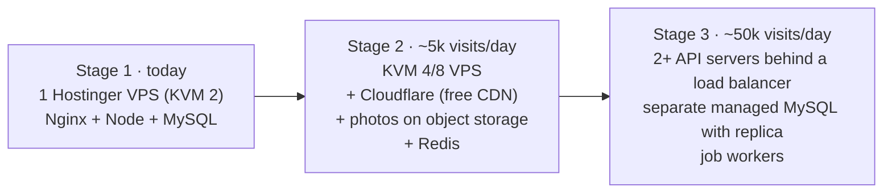

# 9. Growing Ayana: interface, API, database and servers

Today Ayana is **one company selling its own journeys**. "Expanding the network" usually means three things, in this order:

1. **More journeys and places** (more dhams, states, countries, languages) – small changes.
2. **Partner operators** – local tour operators, ashrams, hotels list their packages on Ayana; you take a commission. This turns Ayana into a true **multi-vendor marketplace** – the biggest change.
3. **More traffic** – thousands of visitors a day, Android/iOS apps – server changes.

---

## 9.1 Interface changes as you expand

| Stage | What the customer sees | What changes in code |
|---|---|---|
| More dhams | More temples in the 3D scene, more chips | Add entries to `client/src/three/dham/dhams.js`. Beyond ~7 temples, switch the scene to "rings": Char Dham / 12 Jyotirlingas / Buddhist circuit, each a small arc (group field in `dhams.js`) |
| States & circuits | "Explore Uttarakhand", "Char Dham circuit" pages | New `Region` table + `/regions/:slug` page reusing the listing |
| Hindi & regional languages | Language switch in the menu | `react-i18next` for UI text; `PackageTranslation` table for package content (9.3) |
| Partner operators | "Operated by Shivam Travels ★4.7" on cards; operator profile page | `Vendor` table + vendor badge in `PackageCard` |
| Vendor portal | Operators log in at `/partner` to manage *their* packages, dates, photos, bookings | Copy of the admin Packages/Bookings tabs, filtered by `vendorId` |
| Better booking | Traveller names/ages per seat, coupons, pay 25 % now, room sharing, add-ons (helicopter, pony) | `Traveler`, `Coupon`, `AddOn` tables; checkout steps |
| Trust & support | WhatsApp support button, live booking status, PDF voucher & GST invoice | Notification service, PDF generation |
| Content | Blog / pilgrimage guides for Google search | `Article` table or a headless CMS |

---

## 9.2 API changes

1. **Versioning before the mobile app**: keep today's routes as `v1` by serving them at both `/api` and `/api/v1`.
   Breaking changes go to `/api/v2` so older app versions keep working.
   ```js
   // server/src/app.js
   for (const base of ['/api', '/api/v1']) { app.use(`${base}/auth`, authRoutes); /* ...same for others */ }
   ```
2. **Roles**: `USER`, `VENDOR`, `ADMIN`, `SUPPORT`. Add `requireRole('VENDOR')` middleware next to `requireAdmin`.
3. **New route groups**

| Routes | Purpose |
|---|---|
| `GET /api/v1/vendors/:slug` | public operator profile |
| `/api/v1/vendor/*` | operator portal: own packages, departures, photos, bookings, payouts (every query filtered by `req.user.vendorId`) |
| `POST /api/v1/admin/vendors/:id/approve` | you approve operators and their packages before they go live |
| `POST /api/v1/coupons/validate` | check a coupon at checkout |
| `POST /api/v1/admin/bookings/:id/refund` | Razorpay Refunds API + `Refund` row |
| `POST /api/v1/devices` | mobile push-notification tokens |
| `POST /api/v1/auth/refresh` | refresh tokens so the app stays logged in |
| `POST /api/v1/auth/otp` | phone OTP login (MSG91/Twilio) – most Indian customers prefer it |
| `GET /api/v1/search?q=` | fast search (MySQL FULLTEXT first, Meilisearch later) |

4. **Payments for vendors**: use **Razorpay Route** – the customer pays Ayana, Razorpay automatically transfers the
   operator's share to their linked account and keeps your commission. Store each transfer in a `Payout` row.
5. **Background jobs**: move the seat-expiry timer, emails, WhatsApp messages and PDF invoices to a job queue
   (BullMQ + Redis) once you run more than one API process.

---

## 9.3 Database changes (Prisma)

Add these models step by step (each step = one `npx prisma migrate dev`). Existing data keeps working: new columns are optional at first.

```prisma
enum Role { USER VENDOR ADMIN SUPPORT }

model Vendor {
  id             String   @id @default(cuid())
  slug           String   @unique
  name           String
  gstin          String?
  phone          String
  email          String
  status         String   @default("PENDING") // PENDING, APPROVED, SUSPENDED
  commissionPct  Decimal  @default(12.0) @db.Decimal(5, 2)
  razorpayAccountId String?  // linked account for Razorpay Route
  ratingAvg      Float    @default(0)
  users          User[]
  packages       Package[]
  payouts        Payout[]
  createdAt      DateTime @default(now())
}

// User gets:   vendorId String?  vendor Vendor? @relation(...)
// Package gets: vendorId String?  vendor Vendor? @relation(...)
//               status   String @default("PUBLISHED")  // DRAFT, IN_REVIEW, PUBLISHED

model Region {            // State / circuit, e.g. Uttarakhand, Char Dham
  id       String @id @default(cuid())
  slug     String @unique
  name     String
  parentId String?        // circuits inside a state, states inside a country
  destinations Destination[]
}

model Traveler {          // one row per person on a booking
  id        String  @id @default(cuid())
  bookingId String
  name      String
  age       Int
  gender    String?
  idProofLast4 String?   // never store full Aadhaar numbers
}

model Coupon {
  id         String   @id @default(cuid())
  code       String   @unique
  percentOff Int?
  amountOff  Int?     // paise
  validTill  DateTime
  maxUses    Int?
  used       Int      @default(0)
}

model Refund {
  id         String   @id @default(cuid())
  paymentId  String
  amount     Int
  razorpayRefundId String? @unique
  reason     String
  status     String   @default("PENDING")
  createdAt  DateTime @default(now())
}

model Payout {            // commission split per booking for a vendor
  id         String @id @default(cuid())
  vendorId   String
  bookingId  String @unique
  gross      Int
  commission Int
  net        Int
  transferId String?    // Razorpay Route transfer id
  status     String @default("PENDING")
}

model PackageTranslation {
  id          String @id @default(cuid())
  packageId   String
  locale      String          // "hi", "ta", "bn"
  title       String
  summary     String @db.VarChar(400)
  description String @db.Text
  @@unique([packageId, locale])
}

model DeviceToken {       // for Android/iOS push notifications
  id        String   @id @default(cuid())
  userId    String
  token     String   @unique
  platform  String   // android | ios | web
  createdAt DateTime @default(now())
}

model AuditLog {          // who changed what in admin / vendor portals
  id        String   @id @default(cuid())
  userId    String
  action    String
  entity    String
  entityId  String
  data      Json?
  createdAt DateTime @default(now())
}
```

Also add **booking.couponId**, **booking.paidAmount** (for part payments) and **payment.kind** (`ADVANCE` / `BALANCE`).

---

## 9.4 Server growth path



| Stage | Change | Why |
|---|---|---|
| 2 | Upgrade VPS plan in hPanel (one click, same IP) | More CPU/RAM |
| 2 | Put the domain behind **Cloudflare** (free) | Caches photos and site files worldwide, blocks attacks |
| 2 | Move photos from disk to **object storage** (Cloudflare R2 / AWS S3) | Disk stops being a limit; multiple servers can share photos. Only `imageService.js` changes |
| 2 | Redis | Cache package lists, rate limits, job queue |
| 3 | Database on its own server (managed MySQL), daily automatic backups, a read replica for analytics | The API servers become replaceable |
| 3 | 2+ API servers, `instances: 'max'` in PM2, seat-expiry as a separate cron worker | Handles load and survives a server failure |

The code is already prepared for this: no session state on the server (JWT tokens), seat holds are done in SQL
(safe with many servers), and settings come from `.env`.
