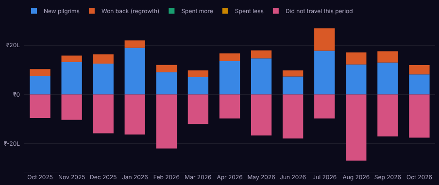
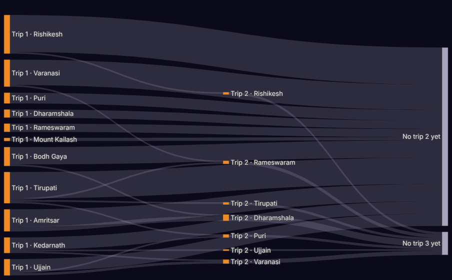
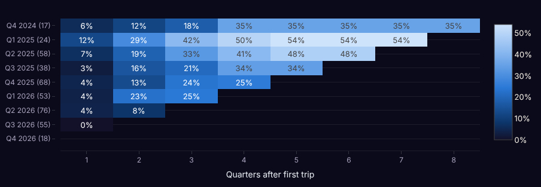

# 11. Ayana Insights – analytics for admins (Python · Streamlit)

Ayana Insights is a separate admin-only app that reads the same database as the website and answers:
**Are we growing? Where does growth come from? How do pilgrims move from one dham to the next? Who are we losing,
and who should we call?**

## 11.1 Opening it

| Where | Address | How it runs |
|---|---|---|
| Your laptop | http://localhost:8501 | `cd analytics && source .venv/bin/activate && streamlit run Home.py` |
| Live | https://yourdomain.com/insights/ | systemd service `ayana-insights`, behind Nginx |
| From the website | Admin → Analytics → **Open Ayana Insights** | link |

Sign in with an **admin** account (the same email and password as the website admin). Customers cannot open it.
Data is cached for 10 minutes; press **Refresh data** in the sidebar to see the latest bookings at once.

## 11.2 The sidebar filters (apply to every page)

| Filter | What it does |
|---|---|
| **Period** | Date range to analyse (default: last 12 months) |
| **Group by** | Month, Quarter or Year. Pilgrimages are seasonal and many people travel once a year, so *Quarter* or *Year* shows trends more clearly than *Month* |
| **Call a customer lost after (days without a trip)** | The churn window **W** (default 365). Changes every churn and status number |
| **Destinations / Journey types** | Look at one dham or one kind of journey only |

## 11.3 The pages

### Overview (`Home.py`)
- Six headline numbers vs the **previous period of the same length**: revenue, paid trips, paying customers, new
  pilgrims, share of repeat trips, average booking.
- Plain-language highlights (growth, best month, value of at-risk customers, pilgrims won back).
- Revenue per period with a 3-period average, and all customers by status today.

### Revenue growth & regrowth (`pages/1_Revenue_growth.py`)
- Revenue per period; growth vs the previous period (blue up, orange down); growth vs the same period last year.
- **Where the growth came from** (growth accounting):

  

  Above zero: **New pilgrims**, **Won back (regrowth)**, **Spent more**. Below zero: **Spent less**,
  **Did not travel this period**. The **quick ratio** = gains ÷ losses; above 1 the business is growing from its
  customers, above 4 is excellent.
- **New vs returning pilgrims**: revenue from first trips vs repeat trips.
- **Rebounds after a dip**: periods where revenue fell and then recovered, with how much of the earlier peak was regained.
- Revenue by destination over time (top 5 + Other).

### How customers move (`pages/2_Customer_journey.py`)
- **Funnel**: signed up → started a booking → paid → 2nd trip → 3+ trips, with the biggest drop called out.
- What happens to bookings (paid / not paid in time / cancelled) and **second chances** (customers whose booking
  failed but who paid later).
- **Where pilgrims go next** – trip 1 → trip 2 → trip 3 by destination or journey type:

  

  Use it to decide what to offer after each trip (e.g. Varanasi pilgrims often go to Kedarnath or Puri next).
- Journey type → next journey type heatmap.
- Timing: days from sign-up to first booking, between trips, and how far ahead people book.
- Sign-ups vs first paid trips per period.

### Churn & retention (`pages/3_Churn_and_retention.py`)
- Customers by status: **Active**, **At risk**, **Lost (churned)**, **Never booked**.
- Churn rate per period, and lost vs won back.
- **Do first-time pilgrims come back?** Cohort heatmap:

  

  Each row = customers whose first trip was in that quarter (group size in brackets). Each column = quarters later.
  The value = share of the group who had booked another trip by then. Rows that turn light faster are better.
- **Who to call this week**: at-risk customers, highest spenders first, with phone and email – download as CSV.

### Customer segments (`pages/4_Customer_segments.py`)
RFM scores and seven segments, each with a suggested action and a downloadable list.

### Journeys & seats (`pages/5_Journeys_and_seats.py`)
Revenue by journey, share of bookings not completed per journey, how full past departures were (by destination and
overall), upcoming departures and the journey table with ratings.

## 11.4 Exact definitions

All calculations live in `analytics/ayana_analytics/metrics.py` and are checked by `analytics/tests/test_metrics.py`.

| Term | Definition |
|---|---|
| **Order** | A booking with a `PAID` payment. Revenue = sum of paid payment amounts, dated by payment time |
| **New pilgrim** (in a period) | A customer whose **first ever** paid trip falls in that period |
| **Repeat trip** | Any paid trip that is not the customer's first |
| **Growth vs previous** | (revenue this period − previous period) ÷ previous period |
| **Growth vs last year** | Same, compared with 12 months / 4 quarters / 1 year earlier |
| **Growth accounting** | Per customer, compare revenue in this period with the previous one. *New*: first ever trip. *Won back*: nothing last period but travelled before. *Spent more / less*: travelled both periods, difference. *Did not travel*: spent last period, nothing now (shown negative). *Quick ratio* = (new + won back + spent more) ÷ (spent less + did not travel) |
| **Active / At risk / Lost** | Days since last paid trip ≤ W/2 / between W/2 and W / more than W. *Never booked*: signed up, no paid trip |
| **Lost in a period** | A customer whose last trip + W falls inside the period with no new trip in between |
| **Won back** | A paid trip that comes more than W days after the previous one |
| **Churn rate** | Lost during the period ÷ customers active at its start (a trip in the W days before it) |
| **Cohort repeat rate** | Of customers whose first trip was in period P, the share with another paid trip within k periods |
| **RFM** | R = recency score 1–5 (more recent = higher), F = number of trips (capped at 5), M = lifetime spend score 1–5 (quintiles) |
| **Segments** | *Can't lose them*: F≥3, R≤2, M≥4 · *Champions*: R≥4, F≥3 · *At risk*: F≥2, R≤2 · *Loyal*: F≥2 · *New pilgrims*: F=1, R≥4 · *Promising*: F=1, R=3 · *Hibernating*: the rest |
| **Seats filled** | `seats_booked ÷ seats_total` for departures that have started |
| **Not completed** | Bookings that expired or were cancelled ÷ all bookings, per journey |

## 11.5 Adding your own chart

1. Add a function to `analytics/ayana_analytics/metrics.py` that takes pandas tables and returns a table.
2. Add a test with a few hand-made rows to `analytics/tests/test_metrics.py`; run `pytest`.
3. In a page file, call it and draw it with Plotly, then `show(style(fig))`. Use `SAFFRON` for a single series,
   `SERIES[0]`, `SERIES[1]`… in order for several, `money_axis(...)` for ₹ axes.
4. Ask Cursor: *"Using docs/11-streamlit-analytics.md, add a page showing revenue per journey type by quarter."*

Colours: a colour-blind-safe palette tested on the dark background; green/amber/red are kept only for customer
status and always appear with a text label.

## 11.6 Safety
- Login: only `role = ADMIN` users, password checked with bcrypt.
- In production it connects with the **read-only** MySQL user `ayana_read` (`analytics/.env`), so it can never change data.
- It runs only on `127.0.0.1:8501`; the internet reaches it only through Nginx over HTTPS at `/insights/`.
- Lists contain customer phone numbers: share admin accounts only with staff who call customers.
